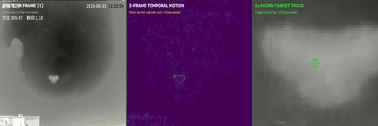
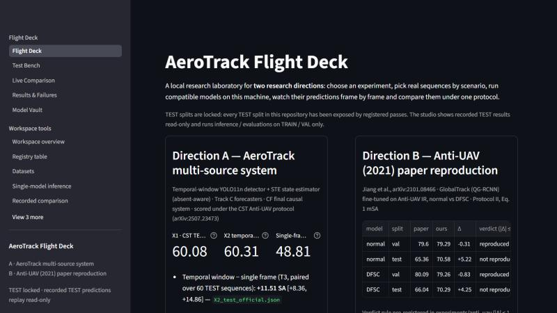
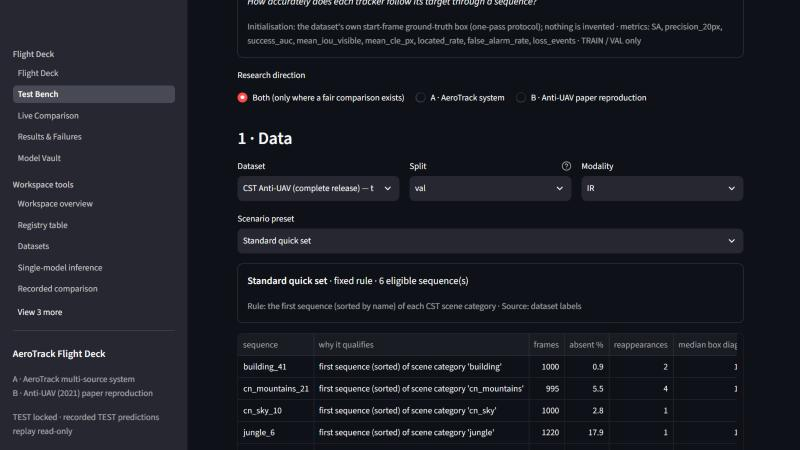
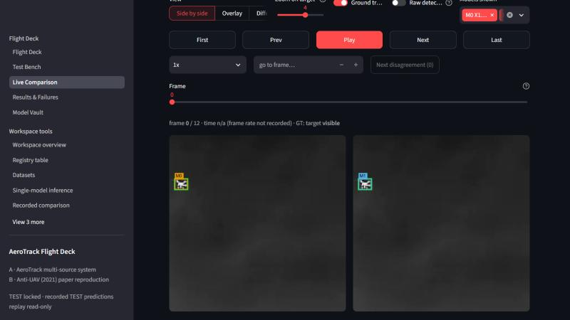
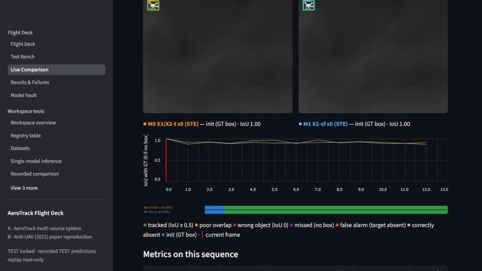
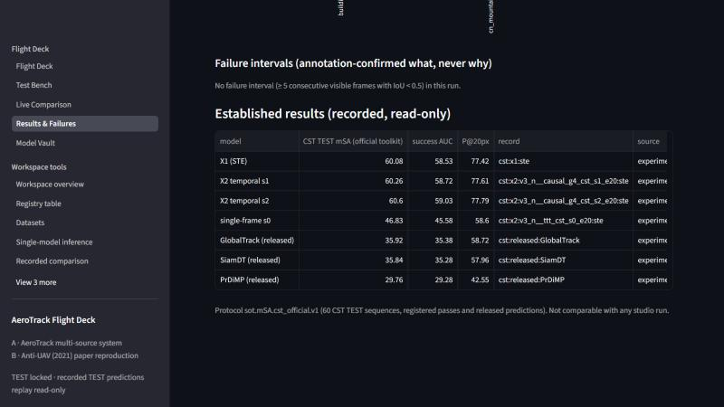
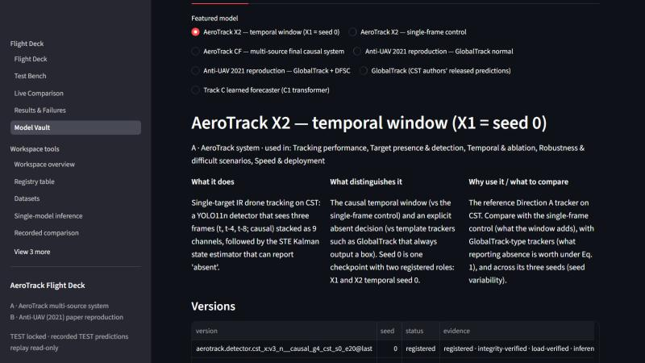

<div align="center">

# DRONE-Track

### Finding a four-pixel drone in thermal video — and keeping hold of it

**AeroTrack-Net** · a causal temporal-window detector + a state estimator that knows when the target is gone

[](#results)
[](#results)
[](#deployment)
[](#how-it-works)



<sub>left: the raw thermal frame · middle: what three stacked frames reveal — static clutter cancels, the drone pops · right: the tracked target at 6×</sub>

</div>

---

## The problem

A drone a kilometre out is a few pixels on a thermal sensor. In a single frame it looks just like a
bird, a hot rooftop edge or sensor noise. Most trackers are built for targets that fill a real part
of the image; on the [CST Anti-UAV](https://arxiv.org/abs/2507.23473) benchmark the best of 21
published trackers reaches **35.92** state accuracy.

What actually separates a drone from clutter at that size is **motion**. So instead of asking a detector
to find it in one frame, we show it three.

## Results

Scored with the benchmark authors' **official toolkit**, unmodified, on the official 60-sequence TEST split.

| method | **mSA** | success AUC | P@20px | tiny-target SA |
|---|---:|---:|---:|---:|
| PrDiMP | 29.76 | 29.28 | 42.55 | 28.21 |
| SiamDT | 35.84 | 35.28 | 57.96 | 14.98 |
| GlobalTrack — *best published* | 35.92 | 35.38 | 58.72 | 15.83 |
| AeroTrack, single frame *(control)* | 48.81 | 45.58 – 48.49 | 58.60 – 62.33 | 31.03 – 31.38 |
| **AeroTrack, temporal window** | **60.31** | 58.53 – 59.03 | 77.42 – 77.79 | 39.88 – 42.45 |

All methods trained on CST train only. Ranges are over three seeds.

<details>
<summary><b>The statistics behind those rows</b></summary>

<br>

| comparison | Δ mSA [95 % CI] | wins / losses | verdict |
|---|---|---|---|
| ours − GlobalTrack, paired over 60 sequences | **+24.39** [+21.08, +27.80] | **60 / 0** | exceeds |
| every seed vs 35.92 | lower CI bounds 56.13 / 56.29 / 56.66 | — | seed-robust |
| temporal window − single frame | **+11.51** [+8.36, +14.86] | 45 / 15 | supported |
| causal window − symmetric window | +0.0074 AP50 [−0.000, +0.016] | — | non-inferior |

- Three seeds: **60.08 / 60.26 / 60.60** (sd 0.26). No averaged checkpoint — each seed is a real file you can run.
- All 21 published trackers were re-scored from the authors' released predictions and match their
  paper to rounding, so the 35.92 baseline is checked, not quoted.
- Roughly half the margin is a better box on visible frames; the rest is correctly saying
  *"not there"* on absent ones.
- TEST was opened by two pre-registered passes and is now locked.

Full write-up: [`experiments/cst_anti_uav/reports/FINAL_REPORT.md`](experiments/cst_anti_uav/reports/FINAL_REPORT.md) ·
every number in one place: [`SUBMISSION/RESULTS_ALL.md`](SUBMISSION/RESULTS_ALL.md)

</details>

## How it works

```
  frames t-8, t-4, t ──► letterbox 640² ──► stack → 9 channels ──► YOLO11n (stride) ──► detections
                                                                                          │
                       box, or "absent"  ◄──  STE: Kalman + explicit ABSENT state  ◄──────┘
```

- **Causal temporal window.** Three frames, four apart, stacked as nine input channels. Past frames only —
  zero look-ahead, so it runs live. Static clutter cancels between frames; a moving target doesn't.
- **Small detector.** YOLO11n, 2.6 M parameters, two classes (`uav_drone`, `bird_hard_negative`).
- **A tracker that can say "gone".** A Kalman filter with an explicit *absent* state, started from the
  first frame's box. Most trackers always output a box; this one stops when the drone leaves the frame,
  which the benchmark scores — and which matters in a real alarm system.

Architecture in detail: [`SUBMISSION/ARCHITECTURE.md`](SUBMISSION/ARCHITECTURE.md)

## The Flight Deck

A local lab for running, replaying and comparing every model in the repo — one command, opens in the browser.

```bat
studio.bat
```

<table>
<tr>
<td width="50%"></td>
<td width="50%"></td>
</tr>
<tr>
<td><b>Home</b> — both research directions and their headline numbers, read live from the result files</td>
<td><b>Test Bench</b> — pick a category, a dataset and a scenario preset; sequences are chosen by a stated rule, not by hand</td>
</tr>
<tr>
<td></td>
<td></td>
</tr>
<tr>
<td><b>Live Comparison</b> — models side by side on the same frames; step through or play</td>
<td><b>Per-frame IoU</b> against ground truth, every frame classed: tracked, missed, wrong object, false alarm</td>
</tr>
<tr>
<td></td>
<td></td>
</tr>
<tr>
<td><b>Results & Failures</b> — your runs and the published evidence, kept in separate tables</td>
<td><b>Model Vault</b> — every checkpoint with its SHA-256, its evidence and its known failure modes</td>
</tr>
</table>

TEST is locked inside the lab: it runs on train and validation only and replays recorded test
predictions read-only, so nothing in it can be used to tune against the test set.

## Quick start

```bat
py -3.11 -m venv venv
venv\Scripts\python.exe -m pip install -r requirements.txt

DEMO.bat        &rem guided walkthrough: environment, datasets, checkpoints, results, live demo
studio.bat      &rem the Flight Deck at http://localhost:8501
```

In `DEMO.bat`, press **A** to run the whole walkthrough in order. Everything it does is read-only.

## Datasets

| dataset | modality | size | frames | split (train / val / test) |
|---|---|---:|---:|---|
| [Anti-UAV 2021](https://github.com/ZhaoJ9014/Anti-UAV) | paired IR + RGB | 318 sequences | 593,802 | 160 / 67 / 91 |
| [CST Anti-UAV](https://github.com/PCwenyue/CST-Anti-UAV) | thermal IR | 144 sequences | 162,187 | 120 / 40 / 60 |
| [Det-Fly](https://github.com/Jake-WU/Det-Fly) | daylight RGB | 7,830 images | — | — |

Directory layout, label formats and how the corpus is built: [`SUBMISSION/README.md`](SUBMISSION/README.md) §4.
The data itself isn't in the repo.

## Deployment

The full pipeline — window assembly, detector, estimator — runs at **170 FPS end to end** on a laptop
RTX 5050 with TensorRT fp16. Engines, parity checks and latency tables are in [`deployment/`](deployment/)
and [`experiments/deployment/reports/`](experiments/deployment/reports/).

## Also here: reproducing *Anti-UAV* (2021)

A separate line of work reproducing Jiang et al. ([arXiv:2101.08466](https://arxiv.org/abs/2101.08466)) —
GlobalTrack fine-tuned on Anti-UAV IR, with and without the paper's DFSC module.

| | split | paper | ours (2 seeds) | Δ |
|---|---|---:|---:|---:|
| normal | val | 79.60 | 79.33 | −0.27 |
| normal | test | 65.36 | 70.40 | +5.04 |
| DFSC | val | 80.09 | 79.34 | −0.75 |
| DFSC | test | 66.04 | 70.21 | +4.17 |

Validation reproduces within a point. Test comes out about five points *above* the paper in both arms,
and the paper's DFSC gain doesn't show up — both reported as found.
Details: [`docs/research/anti_uav_paper_reproduction/`](docs/research/anti_uav_paper_reproduction/)

## What we set out to do, and what happened

The first version of this project (Review 2) promised four techniques. Each one was tested against
a control under a fixed protocol. Two held up, two didn't.

| original plan | outcome |
|---|---|
| temporal stacking of frames t−1, t, t+1 | **kept, in a different form.** Adjacent frames didn't help; frames four apart did. The final window uses only past frames (t−8, t−4, t) so it can run live. Worth +11.5 mSA over a single frame. |
| SPD-Conv lossless downsampling | **dropped.** No measurable gain over the same network without it. |
| ByteTrack association | **dropped.** It was never properly wired in. Replaced by a Kalman estimator with an explicit absent state. |
| hardness-aware, domain-balanced sampling | **partly kept.** Birds are a second class in the model, but the sampling scheme's own effect hasn't been isolated in a separate experiment. |
| 85 FPS | **beaten:** 170 FPS end to end. |
| 79.04 % mAP@50 | **withdrawn.** The Review 2 audit found it compared checkpoints on different image sets. Current detector numbers use a larger corpus and aren't comparable with it. |

Not done: **scene understanding.** The system answers one question per frame — drone, bird, or
nothing — and doesn't model the scene around the target.

## Where it still fails

Same test evidence, reported alongside the wins:

- **misses** 11–14 % of visible frames
- **wrong-object** boxes about 10 % of the time
- **false alarms** on 29–38 % of frames where the drone is absent
- **large targets** are the weak spot (23–27 mSA) — CST train has only six large-target frames to learn from

## Repository map

```
DEMO.bat  studio.bat  run_aerotrack.py      entry points

a_inspection/      stage A: dataset inspection and EDA
b_pipeline/        stage B: cleaning, label conversion, splits, temporal stacks
c_model/           stage C: detector config, training, evaluation, the live demo
deployment/        ONNX / TensorRT export and the runtime pipeline
studio/ aerolab/   the Flight Deck and the library behind it

experiments/       one folder per study: cst_anti_uav, anti_uav, aerotrack_v2/v3, temporal, deployment
runs/              training and evaluation run records
benchmark/         benchmark tables and model statistics
registry/          every checkpoint, dataset and result, indexed by SHA-256
artifacts/         ledgers and dataset cards the tools read
audit/             the Review 2 audit and its benchmark scripts

SUBMISSION/        reviewer's guide, all results, architecture
docs/              protocols, the experiment ledger, per-direction write-ups, progress logs
notebooks/         Review 1 and 2 notebooks, the interactive training notebook
environments/      pinned package versions
tools/             registry builders, report renderers, HPC job submission
tests/             unit tests
```

<div align="center">
<br>
<sub>Built on <a href="https://github.com/ultralytics/ultralytics">Ultralytics YOLO11</a> ·
benchmarks by the <a href="https://arxiv.org/abs/2507.23473">CST Anti-UAV</a> and
<a href="https://github.com/ZhaoJ9014/Anti-UAV">Anti-UAV</a> authors</sub>
</div>
