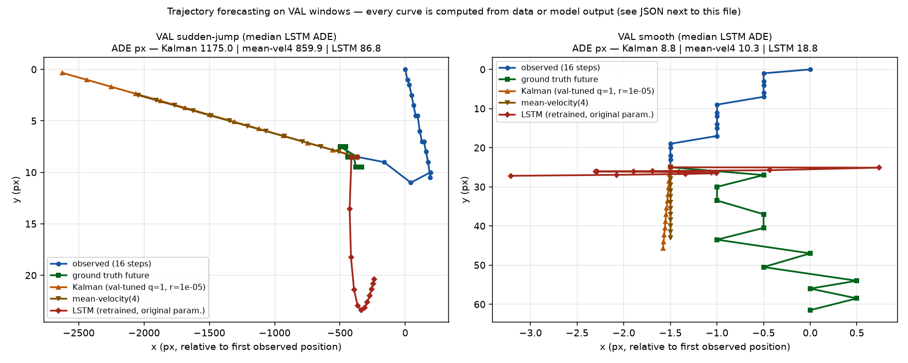
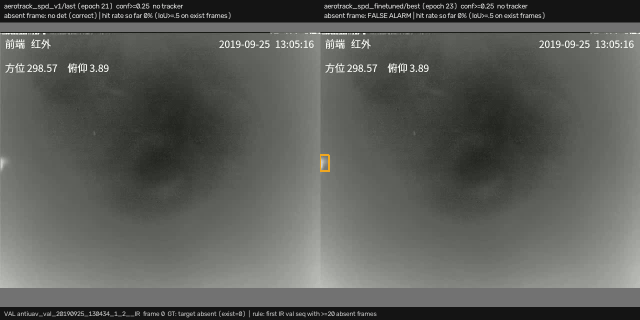

# AeroTrack-Net repair report

*Generated 2026-10-05 14:03 by `render_report.py` on branch `research-program` commit `215d23571b` (dirty: True). Plan: `AEROTRACK_REPAIR_PLAN.md`; audit: `../audit/AUDIT_REPORT.md`.*

## Plan items

| # | item | status |
|---|---|---|
| 1 | same-set v1/v2 evaluation | done — `scripts/evaluate_detector.py`, `reports/detector_val_cap5000.md` |
| 2 | ablations (SPD, temporal, stock YOLO11n) | done — 4 runs × 20 epochs, best.pt and last.pt of each evaluated; verdicts in 'Ablation grid' (`scripts/run_grid.py`, `reports/ablation_grid_e20.md`) |
| 3 | one change at a time from a converged baseline | done — the grid's `baseline_ctrl` (20 epochs, cosine schedule completed) is the reference and every other grid run changes one factor (`run_meta.json`); v1/v2 presented as a recipe change |
| 4 | temporal stack contributes nothing (inference ablation) | audit result cited; training ablation `single_frame` done — temporal stack: no measurable effect on CST AP50 and drone AP50 (rule in 'Ablation grid') |
| 5 | LSTM vs trivial baselines | done — retired by rule (`results/runs/lstm_forecaster_repair/report.md`) |
| 6 | ByteTrack: wire it or drop the claims | done — retired by rule; all ByteTrack captions removed from README/demo |
| 7 | hand-typed trajectory plot | replaced by `docs/assets/repair_forecast_examples_val.png` (+ JSON); rev2.ipynb kept as the historical submission |
| 8 | test-set demo cherry-picking | replaced by `docs/assets/repair_demo_val_*.gif` (VAL, label rule, no tracker claims) |
| 9 | bird→drone false-alarm metric | done — corrected metric in the detector table |
| 10 | latency | done — measured fp32/bf16 with p95 + structural look-ahead |
| 11 | consistent micro definition / epochs / sampler table | done — 'One definition of every term' section, all values read from code/args.json |
| 12 | honest checkpoint selection | done — best.pt and last.pt evaluated side by side; last > best for v1 |
| 13 | reproducible manifests | done — every repair output carries git/env/weights hash/set hash; `train_ablation.py` writes run_meta.json (one record across resumes) |
| 14 | overwritten v2 eval report in the working tree | superseded: the same-set table replaces `results/runs/aerotrack_spd_finetuned/eval_val` (that directory was re-generated and committed in `49bc54c`) |

## Definitions and run facts

### One definition of every term

- **Size bins** (code: `src/model/evaluation.py`): relative box area of the *source* frame — micro < 0.03 %, small 0.03–1 %, standard > 1 %. In pixels (side of a square box at the threshold), computed from the evaluated images:
  anti_uav/IR: micro ≤ 9.9 px, small ≤ 57.2 px; anti_uav/RGB: micro ≤ 24.9 px, small ≤ 144.0 px; cst/IR: micro ≤ 9.9 px, small ≤ 57.2 px; det_fly/RGB: micro ≤ 11.1 px, small ≤ 64.0 px.
- **Evaluation protocol**: conf 0.001, NMS IoU 0.7, max 30 detections/image; FP-rate style numbers at conf 0.25; AP with all-point interpolation over IoU 0.5:0.95. Each checkpoint is scored on its own training input: the t−1,t,t+1 stack, or t,t,t (three copies of frame t) for the runs trained with temporal_gap 0.

| run | planned epochs | epochs run | best.pt (fitness) | last.pt | batch × accumulate | lr0 → lrf | class weights | sampler weights (bird/micro/small/standard/empty) | init |
|---|---|---|---|---|---|---|---|---|---|
| aerotrack_spd_v1 | 150 | 22 (last epoch index 21) | epoch 15 | epoch 21 | 32 × 2 | 0.001 → ×0.01 | [1, 1] | 8.0/6.0/3.0/1.0/0.5 | yolo11n.pt (COCO) |
| aerotrack_spd_finetuned | 25 | 25 (last epoch index 24) | epoch 23 | epoch 24 | 32 × 2 | 0.0002 → ×0.02 | [1.0, 4.5] | 35.0/8.0/4.0/1.0/0.8 | aerotrack_spd_v1 best.pt |
| repair_abl_baseline_ctrl_e20 | 20 | 20 (last epoch index 19) | epoch 13 | epoch 19 | 32 × 2 | 0.001 → ×0.01 | [1, 1] | 8.0/6.0/3.0/1.0/0.5 | yolo11n.pt (COCO), shape-matched |
| repair_abl_no_spd_e20 | 20 | 20 (last epoch index 19) | epoch 10 | epoch 19 | 32 × 2 | 0.001 → ×0.01 | [1, 1] | 8.0/6.0/3.0/1.0/0.5 | yolo11n.pt (COCO), shape-matched + 3-ch stem tiled /3 |
| repair_abl_single_frame_e20 | 20 | 20 (last epoch index 19) | epoch 19 | epoch 19 | 32 × 2 | 0.001 → ×0.01 | [1, 1] | 8.0/6.0/3.0/1.0/0.5 | yolo11n.pt (COCO), shape-matched |
| repair_abl_stock_yolo11n_e20 | 20 | 20 (last epoch index 19) | epoch 18 | epoch 19 | 32 × 2 | 0.001 → ×0.01 | [1, 1] | 8.0/6.0/3.0/1.0/0.5 | yolo11n.pt (COCO), shape-matched + 3-ch stem tiled /3 |

The v1 run was stopped at epoch index 21 of a planned 150 (its cosine schedule never completed); the fine-tune changed the sampler weights, class weights, loss weights, batch, learning-rate schedule and augmentation at once, so its gains are a **recipe change**, not an architectural effect.
The `repair_abl_*` runs use v1's recipe (`baseline` stage, default augmentation and sampler weights — the values v1 was launched with) at a 20-epoch budget whose cosine schedule completes, and differ from each other in one factor.

## Detector — same image set

**Validation** — image set `6fb41d44d45b`: 11,565 images (anti_uav 5,000, cst 5,000, det_fly 1,565), 1714 sequences. Every row uses exactly these images.

| run | ckpt | epoch | input | mAP50 | mAP50-95 | drone AP50 | bird AP50 | micro AP50 (n GT) | small | standard | Anti-UAV | CST | CST micro | Det-Fly | bird-only imgs raising a drone alarm | GT birds boxed as drone | empty-frame drone FP / img |
|---|---|---|---|---|---|---|---|---|---|---|---|---|---|---|---|---|---|
| aerotrack_spd_v1 | best | 15 | t-1,t,t+1 | 0.6074 | 0.2991 | 0.7925 | 0.4224 | 0.2929 (2008) | 0.6240 | 0.4932 | 0.9775 | 0.6767 | 0.6594 | 0.3974 | 20.6 % | 0.8 % | 0.0704 |
| aerotrack_spd_v1 | last | 21 | t-1,t,t+1 | 0.6505 | 0.3188 | 0.8286 | 0.4724 | 0.3293 (2008) | 0.6602 | 0.5358 | 0.9813 | 0.7420 | 0.6846 | 0.4454 | 3.1 % | 0.2 % | 0.0778 |
| aerotrack_spd_finetuned | best | 23 | t-1,t,t+1 | 0.7788 | 0.4140 | 0.8027 | 0.7548 | 0.4078 (2008) | 0.7933 | 0.8454 | 0.9534 | 0.6392 | 0.6091 | 0.7388 | 0.0 % | 0.0 % | 0.0869 |
| aerotrack_spd_finetuned | last | 24 | t-1,t,t+1 | 0.7799 | 0.4158 | 0.8049 | 0.7549 | 0.4062 (2008) | 0.7943 | 0.8547 | 0.9533 | 0.6436 | 0.6112 | 0.7407 | 0.0 % | 0.0 % | 0.0877 |
| repair_abl_baseline_ctrl_e20 | best | 13 | t-1,t,t+1 | 0.6052 | 0.3009 | 0.7791 | 0.4313 | 0.2790 (2008) | 0.6170 | 0.5105 | 0.9751 | 0.6374 | 0.6187 | 0.4095 | 4.1 % | 0.1 % | 0.1200 |
| repair_abl_baseline_ctrl_e20 | last | 19 | t-1,t,t+1 | 0.6409 | 0.3233 | 0.8030 | 0.4788 | 0.2804 (2008) | 0.6585 | 0.6494 | 0.9816 | 0.6677 | 0.6269 | 0.4650 | 4.1 % | 0.1 % | 0.1018 |
| repair_abl_no_spd_e20 | best | 10 | t-1,t,t+1 | 0.6279 | 0.3055 | 0.7975 | 0.4582 | 0.2949 (2008) | 0.6452 | 0.4780 | 0.9718 | 0.7098 | 0.6579 | 0.3908 | 16.5 % | 0.4 % | 0.2409 |
| repair_abl_no_spd_e20 | last | 19 | t-1,t,t+1 | 0.6996 | 0.3453 | 0.8415 | 0.5576 | 0.3588 (2008) | 0.7114 | 0.5387 | 0.9815 | 0.7621 | 0.7288 | 0.5163 | 4.1 % | 0.2 % | 0.1316 |
| repair_abl_single_frame_e20 | best | 19 | t,t,t | 0.6533 | 0.3244 | 0.8065 | 0.5002 | 0.2873 (2008) | 0.6707 | 0.5609 | 0.9807 | 0.6825 | 0.6119 | 0.4559 | 7.2 % | 0.1 % | 0.0778 |
| repair_abl_single_frame_e20 | last | 19 | t,t,t | 0.6533 | 0.3244 | 0.8065 | 0.5002 | 0.2873 (2008) | 0.6707 | 0.5609 | 0.9807 | 0.6825 | 0.6119 | 0.4559 | 7.2 % | 0.1 % | 0.0778 |
| repair_abl_stock_yolo11n_e20 | best | 18 | t,t,t | 0.6708 | 0.3371 | 0.8337 | 0.5079 | 0.3182 (2008) | 0.6837 | 0.5894 | 0.9820 | 0.7305 | 0.7078 | 0.5208 | 1.0 % | 0.0 % | 0.1167 |
| repair_abl_stock_yolo11n_e20 | last | 19 | t,t,t | 0.6790 | 0.3415 | 0.8379 | 0.5200 | 0.3184 (2008) | 0.6937 | 0.5879 | 0.9828 | 0.7327 | 0.7091 | 0.5336 | 3.1 % | 0.1 % | 0.1126 |

**Test (final, once per model)** — image set `37e944793773`: 11,567 images (anti_uav 5,000, cst 5,000, det_fly 1,567), 1809 sequences. Every row uses exactly these images.

| run | ckpt | epoch | input | mAP50 | mAP50-95 | drone AP50 | bird AP50 | micro AP50 (n GT) | small | standard | Anti-UAV | CST | CST micro | Det-Fly | bird-only imgs raising a drone alarm | GT birds boxed as drone | empty-frame drone FP / img |
|---|---|---|---|---|---|---|---|---|---|---|---|---|---|---|---|---|---|
| aerotrack_spd_v1 | best | 15 | t-1,t,t+1 | 0.5491 | 0.2428 | 0.6590 | 0.4391 | 0.2049 (2722) | 0.5693 | 0.4997 | 0.9015 | 0.4471 | 0.3950 | 0.4145 | 18.6 % | 0.7 % | 0.2696 |
| aerotrack_spd_v1 | last | 21 | t-1,t,t+1 | 0.5858 | 0.2629 | 0.6861 | 0.4855 | 0.2543 (2722) | 0.6007 | 0.5630 | 0.9064 | 0.4876 | 0.4236 | 0.4613 | 0.0 % | 0.0 % | 0.4700 |
| aerotrack_spd_finetuned | best | 23 | t-1,t,t+1 | 0.7344 | 0.3776 | 0.6745 | 0.7944 | 0.2862 (2722) | 0.7678 | 0.9079 | 0.8787 | 0.3933 | 0.3174 | 0.7685 | 2.1 % | 0.1 % | 0.4349 |
| aerotrack_spd_finetuned | last | 24 | t-1,t,t+1 | 0.7339 | 0.3774 | 0.6755 | 0.7924 | 0.2877 (2722) | 0.7676 | 0.9073 | 0.8816 | 0.3931 | 0.3182 | 0.7668 | 2.1 % | 0.1 % | 0.4377 |
| repair_abl_baseline_ctrl_e20 | best | 13 | t-1,t,t+1 | 0.5396 | 0.2402 | 0.6557 | 0.4234 | 0.1726 (2722) | 0.5636 | 0.5429 | 0.9012 | 0.4245 | 0.3399 | 0.4017 | 5.2 % | 0.1 % | 0.3878 |
| repair_abl_baseline_ctrl_e20 | last | 19 | t-1,t,t+1 | 0.5693 | 0.2584 | 0.6607 | 0.4779 | 0.1641 (2722) | 0.5982 | 0.6250 | 0.9087 | 0.4118 | 0.3290 | 0.4692 | 4.1 % | 0.0 % | 0.6362 |
| repair_abl_no_spd_e20 | best | 10 | t-1,t,t+1 | 0.5567 | 0.2515 | 0.6528 | 0.4607 | 0.2033 (2722) | 0.5723 | 0.5111 | 0.8992 | 0.4365 | 0.3422 | 0.4026 | 15.5 % | 0.6 % | 0.6953 |
| repair_abl_no_spd_e20 | last | 19 | t-1,t,t+1 | 0.6124 | 0.2776 | 0.6679 | 0.5570 | 0.2129 (2722) | 0.6260 | 0.4870 | 0.9175 | 0.4384 | 0.3353 | 0.5293 | 11.3 % | 0.6 % | 0.7091 |
| repair_abl_single_frame_e20 | best | 19 | t,t,t | 0.5838 | 0.2642 | 0.6740 | 0.4937 | 0.2045 (2722) | 0.6064 | 0.5641 | 0.9012 | 0.4672 | 0.4055 | 0.4688 | 5.2 % | 0.0 % | 0.5891 |
| repair_abl_single_frame_e20 | last | 19 | t,t,t | 0.5838 | 0.2642 | 0.6740 | 0.4937 | 0.2045 (2722) | 0.6064 | 0.5641 | 0.9012 | 0.4672 | 0.4055 | 0.4688 | 5.2 % | 0.0 % | 0.5891 |
| repair_abl_stock_yolo11n_e20 | best | 18 | t,t,t | 0.5778 | 0.2692 | 0.6738 | 0.4819 | 0.2147 (2722) | 0.5860 | 0.6019 | 0.9078 | 0.4508 | 0.3987 | 0.5190 | 1.0 % | 0.1 % | 0.5476 |
| repair_abl_stock_yolo11n_e20 | last | 19 | t,t,t | 0.5913 | 0.2756 | 0.6837 | 0.4988 | 0.2131 (2722) | 0.6061 | 0.6152 | 0.9105 | 0.4561 | 0.3996 | 0.5345 | 2.1 % | 0.1 % | 0.5503 |

*Test split: scored once per checkpoint after the ablation grid finished; `reports/test_evaluation_ledger.jsonl` holds 12 entries for 12 distinct checkpoints. The test table is not used for any checkpoint choice or attribution (the rule is applied on validation).*

**Reading (computed from the table):**
- checkpoint selection: v1 *last* (epoch 21) beats v1 *best* (epoch 15, chosen by the fitness metric) on drone AP50 (0.829 vs 0.792), CST (0.742 vs 0.677) and micro AP50 (0.329 vs 0.293); the fitness metric picked a worse checkpoint.
- fine-tune vs v1-last: drone AP50 -0.026, CST AP50 -0.103, Anti-UAV AP50 -0.028, bird AP50 +0.282, Det-Fly AP50 +0.293; bird-only images raising a drone alarm 3.1 % → 0.0 %.
- so the fine-tune bought bird rejection and paid for it on the thermal drone datasets; the v1/v2 comparison attributes nothing to SPD-Conv or the temporal stack — that is what the controlled ablation grid below is for.

## Ablation grid

Four runs, same recipe (`baseline` stage), same budget, one factor each; both checkpoints evaluated on the same image set as above. **Attribution rule (pre-registered):** a factor is credited only if the full model beats the ablated model by > 0.02 AP50 on the target metric for BOTH last.pt and best.pt; otherwise it has no measurable effect at this budget. Target metrics: SPD → micro AP50 and CST micro AP50; temporal stack → CST AP50 (motion cue) and drone AP50; stock baseline → drone AP50 overall.

| ablation | changes | input | status | epochs | best.pt drone AP50 / micro / CST / CST micro | last.pt drone AP50 / micro / CST / CST micro |
|---|---|---|---|---|---|---|
| baseline_ctrl | full recipe (SPD + 9-ch stack) | t−1,t,t+1 | finished, 2 launches (`repair_abl_baseline_ctrl_e20`) | 20/20 | 0.7791 / 0.2790 / 0.6374 / 0.6187 | 0.8030 / 0.2804 / 0.6677 / 0.6269 |
| no_spd | SPDConv → stride-2 Conv | t−1,t,t+1 | finished (`repair_abl_no_spd_e20`) | 20/20 | 0.7975 / 0.2949 / 0.7098 / 0.6579 | 0.8415 / 0.3588 / 0.7621 / 0.7288 |
| single_frame | t−1 = t = t+1 (no motion) | t,t,t | finished (`repair_abl_single_frame_e20`) | 20/20 | 0.8065 / 0.2873 / 0.6825 / 0.6119 | 0.8065 / 0.2873 / 0.6825 / 0.6119 |
| stock_yolo11n | stride-2 AND single frame (stock YOLO11n) | t,t,t | finished (`repair_abl_stock_yolo11n_e20`) | 20/20 | 0.8337 / 0.3182 / 0.7305 / 0.7078 | 0.8379 / 0.3184 / 0.7327 / 0.7091 |

**Attribution verdicts (rule above):**
- SPD-Conv (no_spd): micro_AP50: Δ best -0.016, last -0.078 → no measurable effect; cst_micro_AP50: Δ best -0.039, last -0.102 → no measurable effect
- temporal stack (single_frame): cst_AP50: Δ best -0.045, last -0.015 → no measurable effect; drone_AP50: Δ best -0.027, last -0.003 → no measurable effect
- full recipe vs stock YOLO11n (stock_yolo11n): drone_AP50: Δ best -0.055, last -0.035 → no measurable effect

`single_frame` and `stock_yolo11n` are trained, validated and scored on t,t,t (three copies of frame t — their input definition, `src/model/train.py::build`); `baseline_ctrl` and `no_spd` on t−1,t,t+1. A verdict only uses finished runs whose evaluated checkpoint hashes match `run_meta.json`.
COCO initialisation, same rule in every run (every tensor whose name and shape match; a 3-channel stem tiled /3 into a 9-channel stride stem): baseline_ctrl 388/649 tensors (59.8 %); no_spd 418/649 tensors (64.4 %); single_frame 388/649 tensors (59.8 %); stock_yolo11n 418/649 tensors (64.4 %). With the installed Ultralytics the C3k2 bottleneck `cv1` convolutions are 1×1 while `yolo11n.pt` holds 3×3 ones, so those and the class head start from scratch in all four runs (and in v1).

Full grid report (training status, runtimes, launches/recoveries, checkpoint hashes, test table): `experiments/aerotrack_repair/reports/ablation_grid_e20.md`.

## Tracking

Detector `aerotrack_spd_finetuned` (sha `72de9bba9fec`), VAL, 5 longest sequences per dataset (track_eval.pick_sequences), first 1200 frames: 10 sequences, 10578 frames, detections at conf 0.05. Every sequence holds one drone.

| tracker | MOTA | IDF1 | ID switches | ID sw. at occlusion re-entry | FP | FN | predicted IDs (GT: 1 per sequence) |
|---|---|---|---|---|---|---|---|
| bytetrack | 0.5957 | 0.3086 | 578 | 0 | 1326 | 1898 | 279 |
| sort | 0.6446 | 0.3066 | 375 | 0 | 368 | 2599 | 258 |
| argmax@0.5 | 0.7349 | 0.8152 | 0 | 0 | 254 | 2239 | 10 |
| argmax@0.25 | 0.7832 | 0.8624 | 0 | 0 | 350 | 1689 | 10 |
| argmax@0.1 | 0.7783 | 0.8691 | 0 | 0 | 601 | 1484 | 10 |
| greedy1@0.25 | 0.7766 | 0.8592 | 0 | 0 | 381 | 1720 | 10 |
| greedy1@0.1 | 0.7574 | 0.8585 | 0 | 0 | 699 | 1582 | 10 |

| dataset | bytetrack | sort | argmax@0.5 | argmax@0.25 | argmax@0.1 | greedy1@0.25 | greedy1@0.1 |
|---|---|---|---|---|---|---|---|
| anti_uav (MOTA / IDF1) | 0.635 / 0.167 | 0.805 / 0.184 | 0.945 / 0.972 | 0.955 / 0.977 | 0.955 / 0.977 | 0.942 / 0.971 | 0.926 / 0.963 |
| cst (MOTA / IDF1) | 0.551 / 0.450 | 0.463 / 0.430 | 0.497 / 0.659 | 0.588 / 0.747 | 0.578 / 0.761 | 0.588 / 0.747 | 0.566 / 0.754 |

**Rule:** ByteTrack is kept only if it beats argmax@0.25 on MOTA and IDF1 on every dataset. **Verdict: ByteTrack RETIRED (a no-association argmax baseline is at least as good).** The demo and this README therefore make no tracking claim; `src/model/bytetrack.py` remains in the repository as an evaluated-and-rejected component.

## Forecasting

Windows: observe 16 steps → forecast 12 (train 89,699 / val 29,229 / test 54,651). ADE in pixels on the TEST windows (lower is better); every method sees the same windows. Selection: per variant: epoch with the lowest VAL ADE; Kalman (q,r) by VAL sweep; TEST scored once for all methods.

| subset | n | zero_vel | last_vel | mean_vel_4 | kalman_project(q=1e-2,r=1e-1) | kalman_val_tuned(q=1,r=1e-05) | lstm_original | lstm_residual_lv | lstm_residual_mv4 |
|---|---|---|---|---|---|---|---|---|---|
| all | 54651 | 41.88 | 57.63 | 56.45 | 56.50 | 54.79 | 38.78 | 40.15 | 39.78 |
| sudden-jump (>30px in horizon) | 10752 | 109.86 | 165.01 | 151.66 | 149.16 | 155.41 | 99.89 | 103.45 | 102.36 |
| smooth | 43899 | 25.23 | 31.33 | 33.13 | 33.80 | 30.15 | 23.81 | 24.64 | 24.46 |
| Anti-UAV | 40314 | 52.31 | 71.90 | 73.36 | 73.69 | 70.13 | 47.44 | 49.34 | 48.91 |
| CST Anti-UAV | 14337 | 12.55 | 17.52 | 8.90 | 8.16 | 11.67 | 14.45 | 14.29 | 14.12 |
| CST sudden-jump | 721 | 60.44 | 89.78 | 52.44 | 49.98 | 63.96 | 62.97 | 62.71 | 63.01 |
| Anti-UAV sudden-jump | 10031 | 113.42 | 170.41 | 158.80 | 156.29 | 161.99 | 102.55 | 106.38 | 105.19 |

Does it move? true mean future step 0.0071 (normalised units); lstm_original: 0.0018; lstm_residual_lv: 0.0019; lstm_residual_mv4: 0.0018.
**Rule:** the LSTM stays only if it beats the best trivial baseline AND the val-tuned Kalman on the CST sudden-jump subset. CST sudden-jump ADE: best LSTM 62.7 vs best trivial 52.4 vs Kalman 64.0 → **LSTM retired.** On gimbal-tracked Anti-UAV footage the best forecaster is 'predict no motion'; the 'sudden jumps' are mostly frame-to-frame discontinuities (gimbal re-slews / label jumps) that no model can anticipate. Caveat: the forecaster's val split contains no CST windows.

*Examples chosen by rule (median LSTM ADE among sudden-jump / smooth VAL windows); every plotted coordinate is in `docs/assets/repair_forecast_examples_val.json`.*

## Latency

`aerotrack_spd_finetuned` epoch 23, NVIDIA GeForce RTX 5050 Laptop GPU, batch 1, 640×640, 200 timed iterations after warm-up.

| stage | mean ms | p50 ms | p95 ms |
|---|---|---|---|
| forward_bf16 | 12.39 | 11.09 | 20.12 |
| forward_fp32 | 8.17 | 7.57 | 10.62 |
| preprocess_3frame_letterbox | 5.76 | 5.67 | 6.36 |
| nms_cpu_demo_conf.25_iou.45 | 0.5 | 0.51 | 0.63 |
| nms_cpu_eval_conf.001_iou.7 | 11.39 | 8.47 | 16.98 |
| bytetrack_update | 0.17 | 0.16 | 0.19 |

- **deployed configuration (fp32, no tracker): 14.43 ms ≈ 69.3 FPS** (bf16 autocast is slower on this GPU at batch 1: 18.65 ms).
- the 3-frame stack needs frame t+1 before frame t can be processed: **+40.0 ms** structural latency at 25 FPS.

## Demo

Sequence `antiuav_val_20190925_130434_1_2__IR` (VAL), frames 0–239; **rule:** first Anti-UAV IR VAL sequence (sorted) with >= 20 exist=0 frames; clip starts 60 frames before the first absent frame. Both panels show raw NMS output at conf 0.25 — no tracker, no trail, no magnifier; green = ground truth. Per-frame IoUs are in `docs/assets/repair_demo_val_antiuav_val_20190925_130434_1_2__IR.json`.

| panel | run / checkpoint | epoch | hit rate (IoU ≥ .5 on frames with a target) | false alarms on frames labelled absent |
|---|---|---|---|---|
| left | aerotrack_spd_v1 / last | 21 | 77.6 % | 21 / 164 |
| right | aerotrack_spd_finetuned / best | 23 | 80.3 % | 98 / 164 |

Labels are taken as given; in this sequence the target is marked absent for most of the clip while it is partly visible at the frame edge in some frames (the Anti-UAV authors later published a start-frame correction for it), so 'false alarms' here include detections of a real object.
