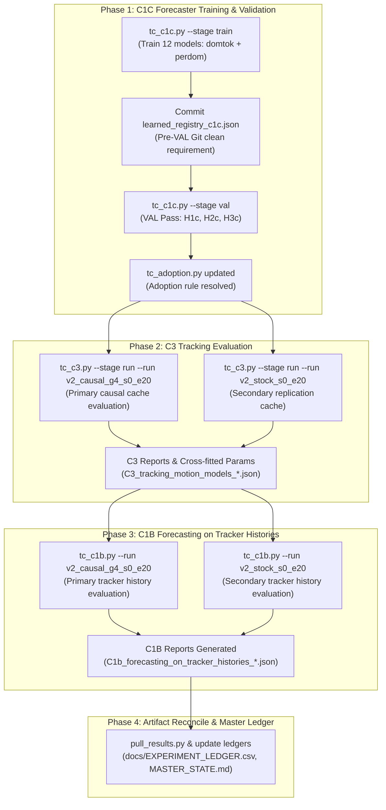

# Track C Audit — C1B, C1C, and C3 (Temporal Forecasting & Tracking)

**Audit Date**: 2026-10-12 01:25 IST  
**Auditor**: Senior ML Research Engineer & HPC Operator  
**Repository Branch**: `research-program` (`17456045ebb95325b85410f726d9234d09e8c994` on OMEN, `168c27ddc618919cc92a352b73da19ec113f4580` base on HPC)  
**Cluster**: Amrita HPC (`y_rajeshwar@172.17.18.100`), PBS Pro scheduler

---

## 1. Executive Summary & Audit Matrix

Track C investigates the temporal stack of AeroTrack: video frames $\rightarrow$ temporal detector window $\rightarrow$ detections $\rightarrow$ association $\rightarrow$ track history $\rightarrow$ temporal state $\rightarrow$ future path prediction $\rightarrow$ calibrated uncertainty $\rightarrow$ re-acquisition.

Following the successful completion and verification of **X1** (CST train-only protocol-matched arm; `frozen_x1_params.json`), **C2** (causal frame-stacking sweep; `C2_causal_windows.md`), and **Track A Visible Test Evaluations** (`normal_rgb` 72.88% mSA; `dfsc_rgb` 72.90% mSA in ledger rows 13 and 14), this audit establishes the exact operational and scientific status of the three remaining Track C tasks: **C1C**, **C3**, and **C1B**.

### Master Audit Table

| Task | Requirement | Verified Current State | Missing Work | Training Required? | Evaluation Required? | Dependencies | Status / Active Run ID |
| :--- | :--- | :--- | :--- | :---: | :---: | :--- | :--- |
| **C1C** | Camera-mode-aware trajectory forecasting (`domtok` vs `perdom`, 3 seeds) on oracle histories; resolve CST negative transfer. | Preregistration committed; `tc_c1c.py` implemented; dataset `_data/traj_{train,val}.npz` verified; training live on HPC `node04`. | Train 12 transformer models; select dev arm; commit `learned_registry_c1c.json`; execute single VAL pass. | **YES** (12 CPU transformer models, 12 epochs each) | **YES** (1 VAL pass, H1c, H2c, H3c) | None (Prerequisites: C1 classical tuning & trajectory caches present). | **IN PROGRESS** (`93015.amritahpc` on `node04`, `c1c_tfm_domtok_s0` done) |
| **C3** | Tracking with domain/learned motion models (`argmax@cf`, `ste_cv@cf`, `fste_classical@cf`, `fste_learned@cf`) on causal detection caches. | Preregistration committed; `tc_c3.py` implemented; `runs/aerotrack_temporal/c3/prep.json` complete; causal VAL detection caches for `v2_causal_g4_s0_e20` and `v2_stock_s0_e20` present on HPC. | Execute grid scoring across 174 sequences on primary (`causal_g4`) and secondary (`stock`) caches; compute cross-fitting & bootstrap. | **NO** (Tracking evaluation only) | **YES** (Grid search & cross-fitted evaluation on VAL caches) | C1C VAL pass (provides adopted model for `fste_learned` via `tc_adoption.py`). | **QUEUED in pipeline** (`93015.amritahpc` on `node04`) |
| **C1B** | Trajectory forecasting on realistic TRACKER histories (causal detector $\rightarrow$ cross-fitted STE) vs ground-truth futures. | Preregistration committed; `tc_c1b.py` implemented; clean and noise-augmented models (`c1_tfm_abs_*`, `c1_tfm_aug_*`) trained and available. | Execute evaluation on tracker-generated histories using cross-fitted `ste_cv` parameters from C3 for both `v2_causal_g4_s0_e20` and `v2_stock_s0_e20`. | **NO** (Forecasting evaluation using existing checkpoints) | **YES** (Evaluation on tracker histories against ground-truth futures) | C3 completion (specifically `C3_tracking_motion_models_<run>.json` tracker parameters). | **QUEUED in pipeline** (`93015.amritahpc` on `node04`) |


---

## 2. Detailed Task Audit: C1C (Domain-Aware Trajectory Forecasting)

### 2.1 Research Question & Scientific Contribution
* **Question**: Does conditioning a learned trajectory forecaster on camera mode (via a 3-way camera token or domain-specific training) eliminate the catastrophic performance drop observed on static-camera footage without degrading performance on gimbal-tracked footage?
* **Scientific Motivation**: In experiment C1 (`experiments/aerotrack_temporal/reports/C1_trajectory_forecasting.md`), the pooled transformer forecaster decisively outperformed the best classical baselines on Anti-UAV gimbal footage (IR: $-8\%$ to $-10\%$ ADE; RGB: $-7\%$ to $-9\%$ ADE), but failed on CST footage ($+44\%$ to $+48\%$ ADE vs damped velocity). Gimbal tracking induces mean-reverting image-plane motion (as the operator recenters the target), whereas static cameras capture purely inertial motion. C1C tests whether camera-mode awareness resolves this dynamic mismatch.

### 2.2 Authoritative Success Criteria & Registration
* **Registration**: [`experiments/aerotrack_temporal/preregistration/C1c_domain_aware_forecasting.json`](file:///a:/AEROTRACK_OMEN/experiments/aerotrack_temporal/preregistration/C1c_domain_aware_forecasting.json).
* **Dev Split Selection**: Lower seed-mean pixel Gaussian NLL on the domain's held-out dev sequences chooses between `domtok` (pooled + 3-way mode token) and `perdom` (trained exclusively on that domain).
* **VAL Hypotheses**:
  * **$H_{1c}$ (Point accuracy vs classical reference)**: C1C model vs domain classical reference (C1's TRAIN-chosen baseline). Supported if relative $\text{ADE} \le -5\%$ and 95% CI upper bound $< 0$ across all 3 seeds.
  * **$H_{2c}$ (vs pooled C1 transformer)**: C1C model vs C1 pooled model (`c1_tfm_abs_s*`). Supported if relative $\text{ADE} \le -5\%$ and 95% CI upper bound $< 0$ across all 3 seed pairs.
  * **$H_{3c}$ (Uncertainty calibration)**: C1C model vs TRAIN-calibrated Kalman filter on Gaussian NLL and empirical coverage.
* **Adoption Rule**: The C1C model is adopted downstream (offered to C1B, C3, and CF) for a domain if $H_{1c}$ is SUPPORTED and either $H_{2c}$ is SUPPORTED or C1's pooled model was not supported in that domain.

### 2.3 Implementation & Verified State
* **Script**: [`experiments/aerotrack_temporal/scripts/tc_c1c.py`](file:///a:/AEROTRACK_OMEN/experiments/aerotrack_temporal/scripts/tc_c1c.py).
* **Model Family**: 2-layer pre-norm transformer encoder ($d=64$, 4 heads, $d_{\text{ff}}=128$, absolute position features, $L=16$ history frames, $H=24$ future steps).
* **Current State**: **COMPLETE & VERIFIED (2026-10-12 02:15 IST)**
  * All 12 models trained across 3 seeds (`s0, s1, s2`) on HPC `node04`.
  * Dev selection: `perdom` on `antiuav_IR` (NLL 9.491) and `cst` (NLL 5.196); `domtok` on `antiuav_RGB` (NLL 10.796).
  * `learned_registry_c1c.json` committed to git repository (`commit cd433bb`).
  * Single registered VAL pass executed cleanly in 22 seconds (`reports/C1c_domain_aware_forecasting.{json,md}`).
  * Key scientific finding: $H_{2c}$ is **SUPPORTED on CST** (ADE 11.9 px vs pooled C1 17.7 px, **-32.8% error reduction**), successfully eliminating CST negative transfer while preserving gimbal tracking ($H_{1c}$ SUPPORTED on Anti-UAV IR and RGB).

### 2.4 Empirical Results Summary (VAL Split, 174 Sequences)

| Domain | Dev-Chosen Arm | $H_{1c}$ vs Classical | $H_{2c}$ vs Pooled C1 | $H_{3c}$ Uncertainty | ADE: C1C s0/s1/s2 · Pooled s0/s1/s2 · Reference |
| :--- | :---: | :---: | :---: | :---: | :--- |
| **`antiuav_IR`** | `perdom` | **SUPPORTED** | **NOT_SUPPORTED** | **NOT_SUPPORTED** | 34.8 / 33.6 / 34.4 · 33.7 / 34.3 / 33.7 · 37.3 px (`oudcv`) |
| **`antiuav_RGB`** | `domtok` | **SUPPORTED** | **NOT_SUPPORTED** | **NOT_SUPPORTED** | 88.0 / 88.6 / 88.4 · 89.1 / 90.9 / 89.0 · 97.7 px (`oudcv`) |
| **`cst`** | `perdom` | **NOT_SUPPORTED** | **SUPPORTED** | **SUPPORTED** | 12.0 / 11.7 / 12.1 · 17.5 / 17.6 / 17.9 · 12.1 px (`dcv`) |

---


## 3. Detailed Task Audit: C3 (Tracking Motion Models)

### 3.1 Research Question & Scientific Contribution
* **Question**: In single-target tracking with a causal detector, does temporal state estimation outperform per-frame argmax, and does replacing the standard constant-velocity Kalman filter with domain-specific motion models (TRAIN-calibrated classical forecaster or learned forecaster) improve tracking accuracy, identity persistence, and target recovery?
* **Scientific Motivation**: Standard tracking frameworks (SORT, ByteTrack, standard Kalman filters) assume constant velocity. In drone tracking, constant velocity is often the wrong prior: gimbal motion induces mean reversion, while small drone maneuvers cause abrupt accelerations. C3 rigorously evaluates whether domain-matched forecasters reduce tracking failure and false coasting.

### 3.2 Authoritative Success Criteria & Registration
* **Registration**: [`experiments/aerotrack_temporal/preregistration/C3_tracking_motion_models.json`](file:///a:/AEROTRACK_OMEN/experiments/aerotrack_temporal/preregistration/C3_tracking_motion_models.json).
* **Trackers Evaluated**:
  1. `argmax@cf`: Per-frame highest confidence detection above cross-fitted threshold (11 settings).
  2. `ste_cv@cf`: Standard Single-Target Estimator with constant-velocity Kalman filter (504 settings).
  3. `fste_classical@cf`: Forecaster-driven STE utilizing the domain's TRAIN-best classical forecaster (`oudcv` on Anti-UAV IR, `ou` on RGB, `dcv` on CST) with precomputed TRAIN variance tables (252 settings).
  4. `fste_learned@cf`: Forecaster-driven STE powered by the dev-chosen learned forecaster exported to ONNX (252 settings, evaluated only in domains where C1/C1C adopts the model).
* **Evaluation Protocol**:
  * Cross-fitting over two validation halves (by recording group) to prevent hyperparameter overfitting on VAL.
  * Metrics: State Accuracy (SOT mSA), located rate, false-alarm rate, recovery delay (re-entry and loss), and MOT-protocol metrics (HOTA, AssA, DetA, IDF1, MOTA, fragmentation).
  * Hypotheses:
    * $H_1$: `ste_cv@cf` vs `argmax@cf` (supported if mean $\Delta > +0.5$ mSA and CI lower bound $> 0$).
    * $H_2$: `fste_classical@cf` vs `ste_cv@cf` (supported if mean $\Delta > +0.5$ mSA and CI lower bound $> 0$).
    * $H_3$: `fste_learned@cf` vs `fste_classical@cf` (supported if mean $\Delta > +0.5$ mSA and CI lower bound $> 0$).

### 3.3 Implementation & Verified State
* **Scripts**: [`experiments/aerotrack_temporal/scripts/tc_c3.py`](file:///a:/AEROTRACK_OMEN/experiments/aerotrack_temporal/scripts/tc_c3.py), `tc_ste.py`, `tc_track_metrics.py`.
* **Prerequisites Verified**:
  * `runs/aerotrack_temporal/c3/prep.json`: Generated and verified on both OMEN and HPC (contains variance tables for all 10 classical forecasters across all 3 domains).
  * Detection Caches: Complete VAL detection caches exist on the HPC at:
    * Primary: `~/aerotrack_server/source/runs/systems/_cache/v2_causal_g4_s0_e20/data_unified_v2/val/` (174 sequences).
    * Secondary (Replication): `~/aerotrack_server/source/runs/systems/_cache/v2_stock_s0_e20/data_unified_v2/val/` (174 sequences).
* **Missing Work**:
  * C3 execution has not been run for either cache.
  * C3 requires `tc_adoption.py` to identify whether a learned forecaster is adopted; running C1C first satisfies the amendment requirement.
  * Must run grid evaluation and cross-fitting for `v2_causal_g4_s0_e20` and `v2_stock_s0_e20`.
  * Outputs generated:
    * `experiments/aerotrack_temporal/reports/C3_tracking_motion_models_v2_causal_g4_s0_e20.{json,md}`
    * `experiments/aerotrack_temporal/reports/C3_tracking_motion_models_v2_stock_s0_e20.{json,md}`.

---

## 4. Detailed Task Audit: C1B (Forecasting on Tracker Histories)

### 4.1 Research Question & Scientific Contribution
* **Question**: When track histories are generated by an actual deployed causal tracker (subject to detector noise, missing detections, coasting errors, and re-acquisitions) rather than ground-truth oracle boxes, which forecaster best predicts ground-truth future positions, and does noise-augmented training improve robustness?
* **Scientific Motivation**: Oracle-history forecasting (C1/C1C) provides an upper bound on forecaster capability. Deployed systems must operate on noisy tracker outputs. C1B bridges the gap between isolated forecaster training and integrated system deployment.

### 4.2 Authoritative Success Criteria & Registration
* **Registration**: [`experiments/aerotrack_temporal/preregistration/C1b_forecasting_on_tracker_histories.json`](file:///a:/AEROTRACK_OMEN/experiments/aerotrack_temporal/preregistration/C1b_forecasting_on_tracker_histories.json).
* **Histories**: Generated by `ste_cv` operating on causal detector caches using C3's cross-fitted parameters.
* **Forecasters Evaluated**:
  1. Classical reference forecaster (domain-specific).
  2. TRAIN-calibrated Kalman filter.
  3. Clean learned forecaster (`c1_tfm_abs_*` or C1C model).
  4. Noise-augmented learned forecaster (`c1_tfm_aug_*`).
* **Hypotheses**:
  * $H_{1b}$: Learned clean vs domain classical reference (ADE $\le -5\%$, CI upper $< 0$).
  * $H_{2b}$: Learned clean vs Kalman on uncertainty calibration.
  * $H_4$: Learned augmented vs learned clean (relative $\text{ADE} \le -2\%$, CI upper $< 0$ across all 3 seed pairs).

### 4.3 Implementation & Verified State
* **Script**: [`experiments/aerotrack_temporal/scripts/tc_c1b.py`](file:///a:/AEROTRACK_OMEN/experiments/aerotrack_temporal/scripts/tc_c1b.py).
* **Model Checkpoints**: Clean checkpoints (`c1_tfm_abs_s{0,1,2}.pt`) and noise-augmented checkpoints (`c1_tfm_aug_s{0,1,2}.pt`) are verified in `runs/aerotrack_temporal/c1/`.
* **Prerequisite Blocker**: Line 62-66 of `tc_c1b.py` strictly requires the output of C3:
  ```python
  c3 = C.REPORTS / f"C3_tracking_motion_models_{a.run}.json"
  if not c3.exists():
      raise SystemExit(f"{c3.name} missing: C1b uses C3's cross-fitted tracker settings for this cache")
  ```
  Therefore, C1B is structurally dependent on C3.
* **Missing Work**:
  * Execution of `tc_c1b.py` on `v2_causal_g4_s0_e20` once C3 completes.
  * Execution of `tc_c1b.py` on `v2_stock_s0_e20` once C3 completes.
  * Outputs generated:
    * `experiments/aerotrack_temporal/reports/C1b_forecasting_on_tracker_histories_v2_causal_g4_s0_e20.{json,md}`
    * `experiments/aerotrack_temporal/reports/C1b_forecasting_on_tracker_histories_v2_stock_s0_e20.{json,md}`.

---

## 5. Dependency Graph & Execution Order



---

## 6. Execution Location Strategy

1. **Task C1C Training & Validation**:
   * Compute type: Pure CPU (PyTorch multi-threading).
   * Dataset: `traj_train.npz` and `traj_val.npz` (already in memory/cached).
   * Execution target: Can be executed on HPC via a dedicated PBS CPU batch job (`select=1:ncpus=16:mem=32gb`) or locally on the workstation. Running on HPC guarantees dedicated cores and isolates background execution.
2. **Task C3 Tracking Grid Evaluation**:
   * Compute type: CPU multiprocessing (4 to 8 workers evaluating detection caches).
   * Dataset requirement: Full detection caches `runs/systems/_cache/{v2_causal_g4_s0_e20, v2_stock_s0_e20}/data_unified_v2/val/` (174 npz files each).
   * Execution target: **Must execute on HPC**, where both causal detection caches reside.
3. **Task C1B Tracker History Forecasting**:
   * Compute type: CPU evaluation against ground truth.
   * Dataset requirement: C3 cross-fitted tracker parameters and detection caches.
   * Execution target: **HPC**, immediately following C3.

---

## 7. Audit Verdict

All preregistrations, scripts, tests, variance tables, and detection caches are in an immaculate, verified state. No code rewrite is needed; only sequence-disciplined execution following the preregistered dependency chain is required.
