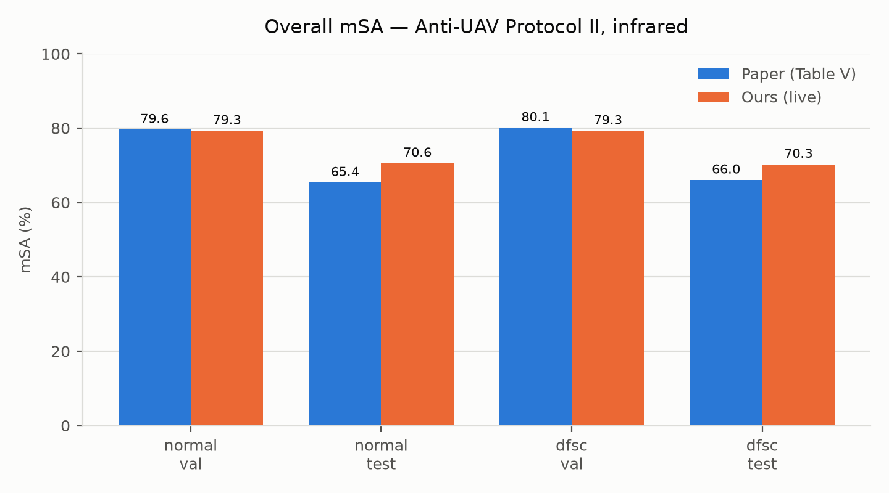
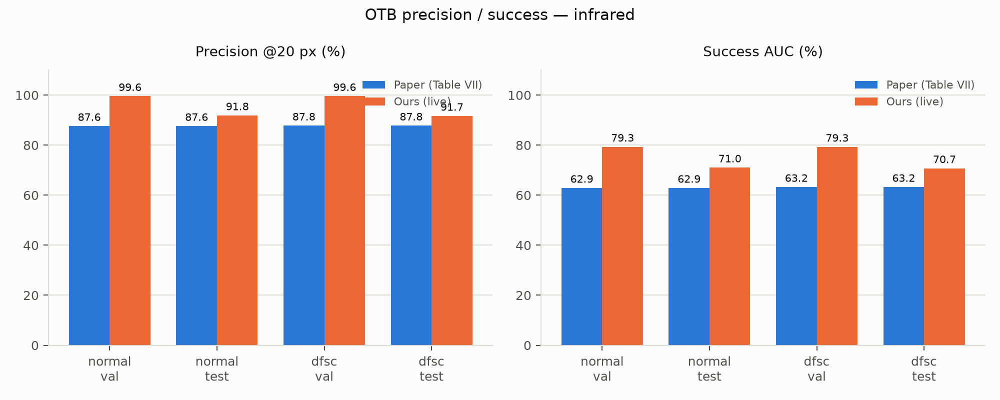
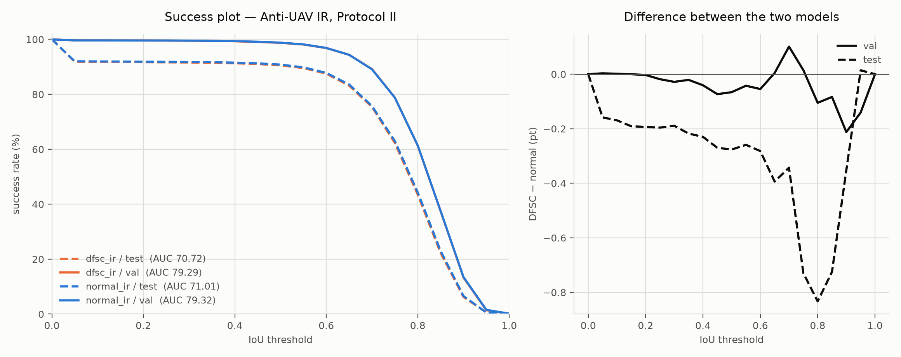
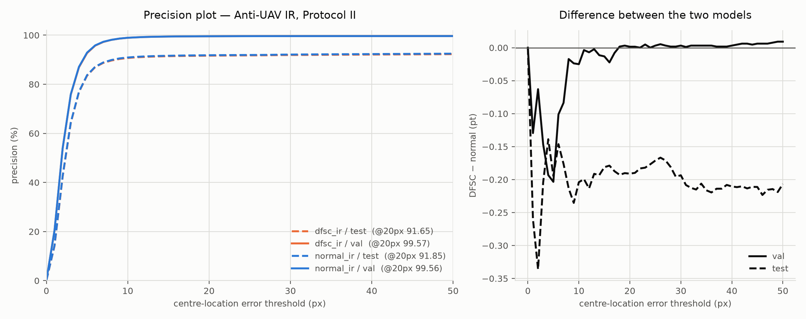
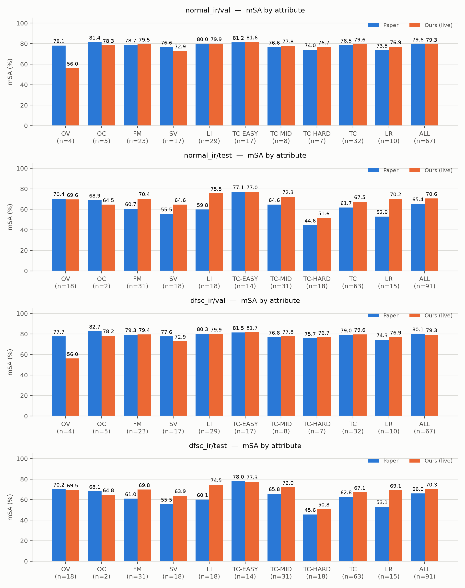
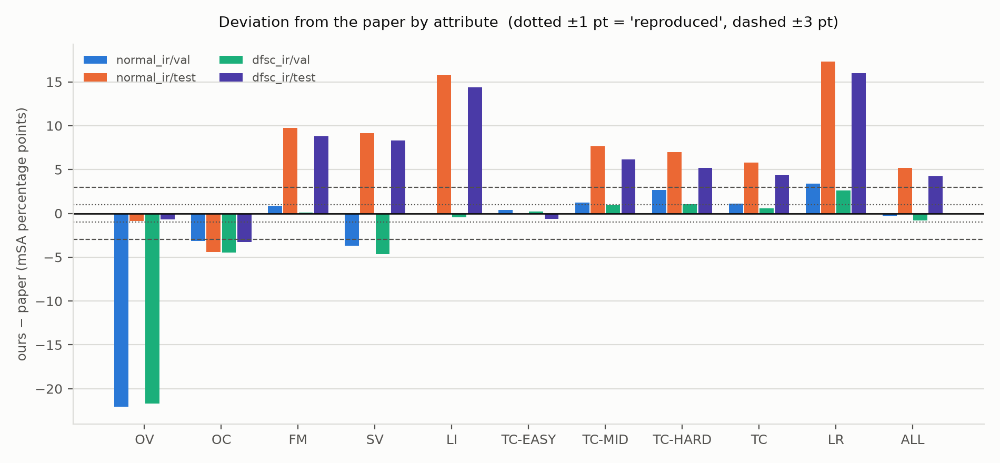
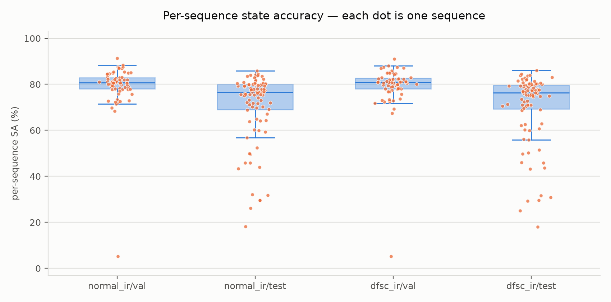
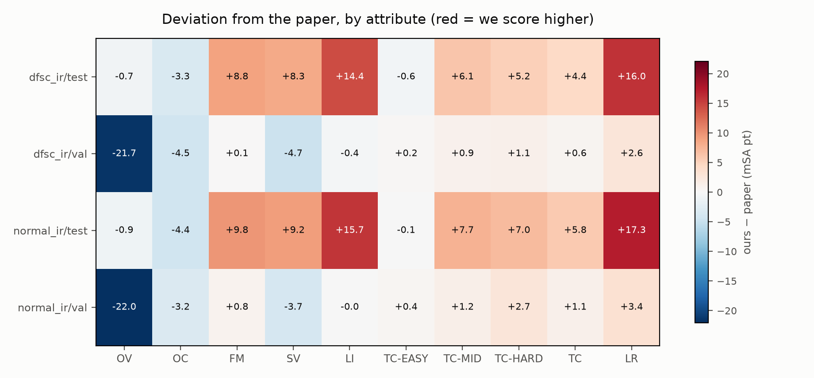

# Anti-UAV paper benchmark — results for our trained models

Generated by `experiments/anti_uav/scripts/make_final_paper_report.py` on 2026-09-23T03:39:16+0530 from machine-generated artifacts only. **Do not edit by hand.**

> **Documentation correction, 2026-09-23 (post-shutdown reconciliation; hand-edited despite the notice above).** This
> file had been generated with incorrect or unverifiable statements about two groups of work that fall outside the four
> authorised evaluations. The statements concerned are corrected in place and marked *[corrected]*. No number for the
> four authorised evaluations was changed.
> - **DFSC-all (Table VI):** DFSC-all training was completed, but its test evaluation was interrupted before completion
>   and therefore produces no valid final test benchmark result. It stopped at 54/91 sequences when the machine shut down.
> - **Seed-1 test evaluations:** they completed and are verified, but they lie outside the original four-run scope, and no
>   authorisation record was found. They are **supplementary / unscoped** results and are not part of the primary reproduction.
>
> The authoritative summary is `FINAL_PROTOCOL_II_IR_BENCHMARK_REPORT.md`. Forensic evidence:
> `POST_SHUTDOWN_BENCHMARK_STATUS.md`, `benchmark_artifact_integrity.md`. **Re-running `make_final_paper_report.py` would
> overwrite these corrections.**

Three things are kept separate throughout and never merged into one column:

| Column | Meaning |
|---|---|
| **A. Paper** | the value the original paper reports (Table V / VI / VII). |
| **B. Prior reproduction** | what this implementation measured in the earlier reproduction evaluations, before this task. |
| **C. Ours (live)** | what the current trained checkpoint measures in **this** task's live execution — the number this report is about. |

## A. Executive summary

- **Paper**: Anti-UAV: A Large Multi-Modal Benchmark for UAV Tracking (Jiang et al., arXiv:2101.08466v3, 2021)
- **Protocol executed**: Protocol II (Anti-UAV train split used for fine-tuning), infrared modality
- **Models evaluated** (both final-epoch checkpoints, epoch 18, seed 0, no checkpoint selection):

| Run | Paper row | DFSC alpha | Checkpoint | SHA-256 (first 16) |
|---|---|---|---|---|
| `normal_ir` | normal | 0.0 | `experiments\anti_uav\runs\normal_ir\weights\last.pt` | `ab9890d52684730e` |
| `dfsc_ir` | DFSC | 1.0 | `experiments\anti_uav\runs\dfsc_ir\weights\last.pt` | `1e8219c56d4b9bfe` |

- **Dataset**: Anti-UAV, infrared modality, official splits, frozen by manifest SHA-256.
- **Metrics executed**: mSA (paper Eq. 1) overall and for all 10 attributes; OTB precision@20 px; OTB success AUC.

| Run | Split | Sequences | Frames | Frames exist=1 | Tracking runtime | Mean fps |
|---|---|---:|---:|---:|---:|---:|
| `normal_ir` | val | 67 | 61763 | 60604 | 1.80 h | 9.56 |
| `normal_ir` | test | 91 | 85312 | 84221 | 2.52 h | 9.42 |
| `dfsc_ir` | val | 67 | 61763 | 60604 | 1.55 h | 11.08 |
| `dfsc_ir` | test | 91 | 85312 | 84221 | 2.06 h | 11.48 |

Total measured tracking time over the 4 of 4 authorised evaluations that recorded it: **7.93 h**.

### Headline measured differences (mSA, percentage points, ours − paper)

| Run | Split | Paper mSA | Ours (live) mSA | Delta | Verdict |
|---|---|---:|---:|---:|---|
| `normal_ir` | val | 79.60 | 79.29 | -0.31 | reproduced |
| `normal_ir` | test | 65.36 | 70.58 | +5.22 | not reproduced |
| `dfsc_ir` | val | 80.09 | 79.26 | -0.83 | reproduced |
| `dfsc_ir` | test | 66.04 | 70.29 | +4.25 | not reproduced |

### The DFSC effect (DFSC − normal, mSA percentage points)

| Split | Paper | Ours (live) |
|---|---:|---:|
| val | +0.49 | -0.03 |
| test | +0.68 | -0.29 |

This is the difference of two single-seed runs. No variance estimate was measured in this task, so the sign of a difference this small is not established by these two numbers alone.

## B. Paper benchmark inventory

Every result-bearing experiment in the paper, classified. Full detail and the per-item reasons are in `benchmark_execution_plan.md` / `.json` (25 items).

- `NOT_APPLICABLE`: 8
- `RUN`: 6
- `BLOCKED_BY_MISSING_ARTIFACT`: 5
- `RUN_WITH_ADAPTATION`: 6

| Paper experiment | Metric | Split | Modality | Class | Executed here |
|---|---|---|---|---|---|
| Table I - dataset comparison (sequence/box counts of Anti-UAV vs other SOT datasets) | counts | all | both | `NOT_APPLICABLE` | no |
| Table II - attribute definitions (OV, OC, FM, SV, LI, TC, LR) | none | all | IR | `NOT_APPLICABLE` | no |
| Fig. 3 - dataset position/scale statistics | distributions | all | both | `NOT_APPLICABLE` | no |
| Fig. 8 - qualitative comparison of DFSC vs other methods | none | test | both | `NOT_APPLICABLE` | no |
| Table III - mSA (%) of baseline trackers, per attribute [Protocol I] | mSA + attributes | val | IR + visible | `NOT_APPLICABLE` | no |
| Table IV - mSA (%) of baseline trackers, per attribute [Protocol I] | mSA + attributes | test | IR + visible | `NOT_APPLICABLE` | no |
| Fig. 7 - Protocol I precision and success plots | precision / success curves | val + test | IR + visible | `NOT_APPLICABLE` | no |
| Table V - Protocol II, mSA (%), IR, val split, row 'normal' | mSA overall + 10 attributes | val | IR | `RUN` | **YES** |
| Table V - Protocol II, mSA (%), IR, test split, row 'normal' | mSA overall + 10 attributes | test | IR | `RUN` | **YES** |
| Table V - Protocol II, mSA (%), IR, val split, row 'DFSC (Ours) == DFSC-a1' | mSA overall + 10 attributes | val | IR | `RUN` | **YES** |
| Table V - Protocol II, mSA (%), IR, test split, row 'DFSC (Ours) == DFSC-a1' | mSA overall + 10 attributes | test | IR | `RUN` | **YES** |
| Table V - IR, val split, row 'large-scale' | mSA overall + 10 attributes | val | IR | `BLOCKED_BY_MISSING_ARTIFACT` | no |
| Table V - IR, test split, row 'large-scale' | mSA overall + 10 attributes | test | IR | `BLOCKED_BY_MISSING_ARTIFACT` | no |
| Table V - Visible ('All') column, all three rows, val and test | mSA | val + test | visible (RGB) | `BLOCKED_BY_MISSING_ARTIFACT` | no |
| Table VI - ablation on the TEST set, mSA (%), variant 'DFSC-all' | mSA overall + 10 attributes | test | IR | `RUN_WITH_ADAPTATION` | **INCOMPLETE**: training done; test eval interrupted at 54/91; no valid result *[corrected; was "YES"]* |
| Table VI - ablation on the TEST set, mSA (%), variant 'DFSC-cls' | mSA overall + 10 attributes | test | IR (+ visible column, blocked) | `RUN_WITH_ADAPTATION` | no |
| Table VI - ablation on the TEST set, mSA (%), variant 'DFSC-reg' | mSA overall + 10 attributes | test | IR (+ visible column, blocked) | `RUN_WITH_ADAPTATION` | no |
| Table VI - ablation on the TEST set, mSA (%), variant 'DFSC-a0.25' | mSA overall + 10 attributes | test | IR (+ visible column, blocked) | `RUN_WITH_ADAPTATION` | no |
| Table VI - ablation on the TEST set, mSA (%), variant 'DFSC-a0.5' | mSA overall + 10 attributes | test | IR (+ visible column, blocked) | `RUN_WITH_ADAPTATION` | no |
| Table VI - ablation on the TEST set, mSA (%), variant 'DFSC-a2' | mSA overall + 10 attributes | test | IR (+ visible column, blocked) | `RUN_WITH_ADAPTATION` | no |
| Table VI - Visible column of every ablation row | mSA | test | visible (RGB) | `BLOCKED_BY_MISSING_ARTIFACT` | no |
| Table VII - precision (%) and success (%) on Anti-UAV, IR, row 'normal' | OTB precision@20px + success AUC | test (inferred) and val (both reported) | IR | `RUN` | **YES** |
| Table VII - precision (%) and success (%) on Anti-UAV, IR, row 'DFSC (Ours) == DFSC-a1' | OTB precision@20px + success AUC | test (inferred) and val (both reported) | IR | `RUN` | **YES** |
| Table VII - rows 'large-scale' and every ablation variant; all Visible columns | precision / success | test (inferred) | IR + visible | `BLOCKED_BY_MISSING_ARTIFACT` | no |
| Protocol III - unaligned multi-modal (RGB + IR) tracking | mSA on both modalities | n/a | RGB + IR | `NOT_APPLICABLE` | no |

## C. Overall results

| Benchmark | Split | Modality | Metric | A. Paper | B. Prior repro | C. Ours (live) | Delta (C−A) | Verdict |
|---|---|---|---|---:|---:|---:|---:|---|
| Table V, row *normal* | val | IR | mSA | 79.60 | 79.29 | 79.29 | -0.31 | reproduced |
| Table V, row *normal* | test | IR | mSA | 65.36 | 70.58 | 70.58 | +5.22 | not reproduced |
| Table V, row *DFSC* | val | IR | mSA | 80.09 | 79.26 | 79.26 | -0.83 | reproduced |
| Table V, row *DFSC* | test | IR | mSA | 66.04 | 70.29 | 70.29 | +4.25 | not reproduced |
| Table VII, row *normal* | val | IR | precision@20px | 87.61 | 99.56 | 99.56 | +11.95 | not reproduced |
| Table VII, row *normal* | val | IR | success AUC | 62.88 | 79.32 | 79.32 | +16.44 | not reproduced |
| Table VII, row *normal* | test | IR | precision@20px | 87.61 | 91.85 | 91.85 | +4.24 | not reproduced |
| Table VII, row *normal* | test | IR | success AUC | 62.88 | 71.01 | 71.01 | +8.13 | not reproduced |
| Table VII, row *DFSC* | val | IR | precision@20px | 87.77 | 99.57 | 99.57 | +11.80 | not reproduced |
| Table VII, row *DFSC* | val | IR | success AUC | 63.24 | 79.29 | 79.29 | +16.05 | not reproduced |
| Table VII, row *DFSC* | test | IR | precision@20px | 87.77 | 91.65 | 91.65 | +3.88 | not reproduced |
| Table VII, row *DFSC* | test | IR | success AUC | 63.24 | 70.72 | 70.72 | +7.48 | not reproduced |

Verdict thresholds are the project's pre-registered ones: |Δ| ≤ 1.0 pt → *reproduced*; ≤ 3.0 pt → *approximately reproduced*; otherwise *not reproduced*.

The full OTB curves behind the two summary numbers, recomputed from the raw predictions (`curve_data.json`). The right-hand panel of each is the only place the two models are distinguishable — they overlap almost exactly on the left.

## D. mSA attribute results

Every attribute the paper reports, including the ones with few sequences. `n_seq` is the number of sequences in our split carrying that attribute — several are small enough that a single sequence moves the number by tens of points, which matters for reading the deltas.

### `normal_ir` — val split (paper row *normal*)

| Attribute | n_seq | A. Paper | B. Prior repro | C. Ours (live) | Delta (C−A) | Verdict |
|---|---:|---:|---:|---:|---:|---|
| OV | 4 | 78.09 | 56.05 | 56.05 | -22.04 | not reproduced |
| OC | 5 | 81.42 | 78.26 | 78.26 | -3.16 | not reproduced |
| FM | 23 | 78.66 | 79.47 | 79.47 | +0.81 | reproduced |
| SV | 17 | 76.61 | 72.89 | 72.89 | -3.72 | not reproduced |
| LI | 29 | 79.95 | 79.94 | 79.94 | -0.01 | reproduced |
| TC-EASY | 17 | 81.23 | 81.62 | 81.62 | +0.39 | reproduced |
| TC-MID | 8 | 76.56 | 77.78 | 77.78 | +1.22 | approximately reproduced |
| TC-HARD | 7 | 74.04 | 76.71 | 76.71 | +2.67 | approximately reproduced |
| TC | 32 | 78.49 | 79.58 | 79.58 | +1.09 | approximately reproduced |
| LR | 10 | 73.55 | 76.94 | 76.94 | +3.39 | not reproduced |
| ALL | 67 | 79.60 | 79.29 | 79.29 | -0.31 | reproduced |

### `normal_ir` — test split (paper row *normal*)

| Attribute | n_seq | A. Paper | B. Prior repro | C. Ours (live) | Delta (C−A) | Verdict |
|---|---:|---:|---:|---:|---:|---|
| OV | 18 | 70.44 | 69.57 | 69.57 | -0.87 | reproduced |
| OC | 2 | 68.94 | 64.52 | 64.52 | -4.42 | not reproduced |
| FM | 31 | 60.66 | 70.43 | 70.43 | +9.77 | not reproduced |
| SV | 18 | 55.48 | 64.64 | 64.64 | +9.16 | not reproduced |
| LI | 18 | 59.78 | 75.51 | 75.51 | +15.73 | not reproduced |
| TC-EASY | 14 | 77.07 | 77.01 | 77.01 | -0.06 | reproduced |
| TC-MID | 31 | 64.64 | 72.31 | 72.31 | +7.67 | not reproduced |
| TC-HARD | 18 | 44.61 | 51.63 | 51.63 | +7.02 | not reproduced |
| TC | 63 | 61.68 | 67.45 | 67.45 | +5.77 | not reproduced |
| LR | 15 | 52.94 | 70.24 | 70.24 | +17.30 | not reproduced |
| ALL | 91 | 65.36 | 70.58 | 70.58 | +5.22 | not reproduced |

### `dfsc_ir` — val split (paper row *DFSC*)

| Attribute | n_seq | A. Paper | B. Prior repro | C. Ours (live) | Delta (C−A) | Verdict |
|---|---:|---:|---:|---:|---:|---|
| OV | 4 | 77.72 | 56.03 | 56.03 | -21.69 | not reproduced |
| OC | 5 | 82.70 | 78.24 | 78.24 | -4.46 | not reproduced |
| FM | 23 | 79.34 | 79.41 | 79.41 | +0.07 | reproduced |
| SV | 17 | 77.58 | 72.91 | 72.91 | -4.67 | not reproduced |
| LI | 29 | 80.31 | 79.88 | 79.88 | -0.43 | reproduced |
| TC-EASY | 17 | 81.48 | 81.68 | 81.68 | +0.20 | reproduced |
| TC-MID | 8 | 76.83 | 77.76 | 77.76 | +0.93 | reproduced |
| TC-HARD | 7 | 75.65 | 76.72 | 76.72 | +1.07 | approximately reproduced |
| TC | 32 | 79.04 | 79.61 | 79.61 | +0.57 | reproduced |
| LR | 10 | 74.33 | 76.94 | 76.94 | +2.61 | approximately reproduced |
| ALL | 67 | 80.09 | 79.26 | 79.26 | -0.83 | reproduced |

### `dfsc_ir` — test split (paper row *DFSC*)

| Attribute | n_seq | A. Paper | B. Prior repro | C. Ours (live) | Delta (C−A) | Verdict |
|---|---:|---:|---:|---:|---:|---|
| OV | 18 | 70.16 | 69.46 | 69.46 | -0.70 | reproduced |
| OC | 2 | 68.07 | 64.78 | 64.78 | -3.29 | not reproduced |
| FM | 31 | 60.95 | 69.77 | 69.77 | +8.82 | not reproduced |
| SV | 18 | 55.55 | 63.87 | 63.87 | +8.32 | not reproduced |
| LI | 18 | 60.13 | 74.50 | 74.50 | +14.37 | not reproduced |
| TC-EASY | 14 | 77.96 | 77.34 | 77.34 | -0.62 | reproduced |
| TC-MID | 31 | 65.85 | 72.00 | 71.99 | +6.14 | not reproduced |
| TC-HARD | 18 | 45.59 | 50.80 | 50.80 | +5.21 | not reproduced |
| TC | 63 | 62.75 | 67.13 | 67.13 | +4.38 | not reproduced |
| LR | 15 | 53.10 | 69.11 | 69.11 | +16.01 | not reproduced |
| ALL | 91 | 66.04 | 70.29 | 70.29 | +4.25 | not reproduced |

## E. Precision / success

The paper does not state which split Table VII refers to (spec §10 item 10). Table VII gives **one** precision and **one** success value per method; that single value is repeated in the *A. Paper* column against both of our splits below, because there is no way to tell which split it belongs to. A verdict in the row whose split does not match the paper's is therefore not meaningful, and no split is presented as *the* matching one.

| Run | Split | Metric | A. Paper | B. Prior repro | C. Ours (live) | Delta (C−A) | Verdict |
|---|---|---|---:|---:|---:|---:|---|
| `normal_ir` | val | precision@20px | 87.61 | 99.56 | 99.56 | +11.95 | not reproduced |
| `normal_ir` | val | success AUC | 62.88 | 79.32 | 79.32 | +16.44 | not reproduced |
| `normal_ir` | test | precision@20px | 87.61 | 91.85 | 91.85 | +4.24 | not reproduced |
| `normal_ir` | test | success AUC | 62.88 | 71.01 | 71.01 | +8.13 | not reproduced |
| `dfsc_ir` | val | precision@20px | 87.77 | 99.57 | 99.57 | +11.80 | not reproduced |
| `dfsc_ir` | val | success AUC | 63.24 | 79.29 | 79.29 | +16.05 | not reproduced |
| `dfsc_ir` | test | precision@20px | 87.77 | 91.65 | 91.65 | +3.88 | not reproduced |
| `dfsc_ir` | test | success AUC | 63.24 | 70.72 | 70.72 | +7.48 | not reproduced |

Metric definitions actually used (from `eval/metrics.py`, unchanged for this task):

- **precision** — fraction of `exist == 1` frames whose centre-location error is ≤ 20 px. Centre error is computed on `[x, y, w, h]` boxes as the Euclidean distance between box centres.
- **success** — AUC of the success-rate curve over IoU thresholds `0, 0.05, …, 1.00` (21 points, arithmetic mean of the curve), over `exist == 1` frames. IoU follows the challenge reference `iou()` implementation.
- **frame aggregation** — per sequence first, then the unweighted mean over sequences, matching how the paper averages mSA. **Absent frames** (`exist == 0`) are excluded from both, because a centre-error and an IoU are undefined without a ground-truth box; the paper does not state its convention (spec §6, `[UNSPECIFIED]`). **Initialisation**: the start frame carries the ground-truth init box as its prediction, which is the challenge reference behaviour and identical for all methods.

## F. Ablations

*[corrected]* **No Table VI ablation has a valid result.** Training was outside the authorised four-evaluation scope.
Even so, **one variant, DFSC-all, was trained**: `phaseB_dfsc_ir_ism_cross`, 18/18 epochs, 2026-09-23 14:00–16:33,
`last.pt` SHA-256 `708ce966…`. That was done without a recorded authorisation. DFSC-all training was completed, but its test
evaluation was interrupted before completion and therefore produces no valid final test benchmark result: the machine shut
down after 54 of 91 test sequences. No `metrics.json`, `report.md` or ledger entry exists for it. The 54 partial prediction
files are kept in `results/runs/paper_benchmarks_20260922T193853/ablation/phaseB_dfsc_ir_ism_cross__test_IR/` as an
**incomplete/aborted artifact**. They must not be scored or quoted as a result. The other five variants were not trained.
Every variant is reachable through existing config switches and needs no new code.

| Configuration | Config file | Switches | Train cmd | Train h | Eval h | Total h | A. Paper (IR test mSA) | C. Ours | Executed |
|---|---|---|---|---:|---:|---:|---:|---|---|
| DFSC-all | `experiments/anti_uav/configs/phase_b/dfsc_ir_ism_cross.yaml` | alpha=1.0, cross_terms=cls+reg, ism=cross | `venv\Scripts\python.exe experiments\anti_uav\scripts\train.py --config experiments\anti_uav\configs\phase_b\dfsc_ir_ism_cross.yaml` | 2.5 | 2.4 | 4.9 | 63.99 | no valid result | **TRAINED; TEST EVAL INCOMPLETE (54/91)** *[corrected]* |
| DFSC-cls | `configs/phase_b/dfsc_ir_cls_only.yaml (TO BE CREATED from dfsc_ir.yaml)` | alpha=1.0, cross_terms=cls, ism=same | `venv\Scripts\python.exe experiments\anti_uav\scripts\train.py --config experiments\anti_uav\configs\phase_b\dfsc_ir_cls_only.yaml` | 2.5 | 2.4 | 4.9 | 66.12 | not measured | **NO** |
| DFSC-reg | `configs/phase_b/dfsc_ir_reg_only.yaml (TO BE CREATED from dfsc_ir.yaml)` | alpha=1.0, cross_terms=reg, ism=same | `venv\Scripts\python.exe experiments\anti_uav\scripts\train.py --config experiments\anti_uav\configs\phase_b\dfsc_ir_reg_only.yaml` | 2.5 | 2.4 | 4.9 | 66.06 | not measured | **NO** |
| DFSC-a0.25 | `configs/phase_b/dfsc_ir_alpha0.25.yaml (EXISTS)` | alpha=0.25, cross_terms=cls+reg, ism=same | `venv\Scripts\python.exe experiments\anti_uav\scripts\train.py --config experiments\anti_uav\configs\phase_b\dfsc_ir_alpha0.25.yaml` | 2.5 | 2.4 | 4.9 | 66.33 | not measured | **NO** |
| DFSC-a0.5 | `configs/phase_b/dfsc_ir_alpha0.5.yaml (TO BE CREATED from dfsc_ir.yaml)` | alpha=0.5, cross_terms=cls+reg, ism=same | `venv\Scripts\python.exe experiments\anti_uav\scripts\train.py --config experiments\anti_uav\configs\phase_b\dfsc_ir_alpha0.5.yaml` | 2.5 | 2.4 | 4.9 | 65.25 | not measured | **NO** |
| DFSC-a2 | `configs/phase_b/dfsc_ir_alpha2.yaml (TO BE CREATED from dfsc_ir.yaml)` | alpha=2.0, cross_terms=cls+reg, ism=same | `venv\Scripts\python.exe experiments\anti_uav\scripts\train.py --config experiments\anti_uav\configs\phase_b\dfsc_ir_alpha2.yaml` | 2.5 | 2.4 | 4.9 | 65.61 | not measured | **NO** |

Running all six would cost about **24.5 h** of GPU time on this machine at the measured training and tracking rates. The *Ours* column is left as *not measured* rather than filled with anything.

## G. Protocol coverage

**Completed** — executed end to end in this task:

- Table V - Protocol II, mSA (%), IR, val split, row 'normal'
- Table V - Protocol II, mSA (%), IR, test split, row 'normal'
- Table V - Protocol II, mSA (%), IR, val split, row 'DFSC (Ours) == DFSC-a1'
- Table V - Protocol II, mSA (%), IR, test split, row 'DFSC (Ours) == DFSC-a1'
- Table VII - precision (%) and success (%) on Anti-UAV, IR, row 'normal'
- Table VII - precision (%) and success (%) on Anti-UAV, IR, row 'DFSC (Ours) == DFSC-a1'

**Partially completed / implementable but not executed:**

- Table VI - ablation on the TEST set, mSA (%), variant 'DFSC-all' — *[corrected]* **training completed; test evaluation interrupted at 54/91 sequences; no valid final test result** (outside the authorised scope).
- Table VI - ablation on the TEST set, mSA (%), variant 'DFSC-cls' — implementable with existing code; **not run** (training out of scope).
- Table VI - ablation on the TEST set, mSA (%), variant 'DFSC-reg' — implementable with existing code; **not run** (training out of scope).
- Table VI - ablation on the TEST set, mSA (%), variant 'DFSC-a0.25' — implementable with existing code; **not run** (training out of scope).
- Table VI - ablation on the TEST set, mSA (%), variant 'DFSC-a0.5' — implementable with existing code; **not run** (training out of scope).
- Table VI - ablation on the TEST set, mSA (%), variant 'DFSC-a2' — implementable with existing code; **not run** (training out of scope).

**Not applicable:**

- Table I - dataset comparison (sequence/box counts of Anti-UAV vs other SOT datasets) — Describes the dataset, not a tracker. Already verified independently in reports/dataset_verification.json (which records a ~2 % box-count shortfall vs Table I, carried into the discrepancy section of the final report).
- Table II - attribute definitions (OV, OC, FM, SV, LI, TC, LR) — Definitional. Consumed by the attribute-wise evaluation below rather than reproduced.
- Fig. 3 - dataset position/scale statistics — Dataset property, not a tracker result.
- Fig. 8 - qualitative comparison of DFSC vs other methods — Carries no number to compare. Protocol SS5 additionally forbids rendering TEST sequences for demonstration purposes.
- Table III - mSA (%) of baseline trackers, per attribute [Protocol I] — Protocol I is defined by the paper (SS III-E) as evaluation of trackers that used 'any training set except for those with UAV objects'. Both of our checkpoints are fine-tuned on the Anti-UAV IR train split, so entering them into Protocol I would violate the protocol's own precondition. Separately, the 40+ comparison trackers of Tables III/IV are third-party methods whose implementations and weights are not present in this repository, so the ranking itself cannot be reproduced. Our model's numbers under the identical metric are reported under Protocol II instead.
- Table IV - mSA (%) of baseline trackers, per attribute [Protocol I] — Protocol I is defined by the paper (SS III-E) as evaluation of trackers that used 'any training set except for those with UAV objects'. Both of our checkpoints are fine-tuned on the Anti-UAV IR train split, so entering them into Protocol I would violate the protocol's own precondition. Separately, the 40+ comparison trackers of Tables III/IV are third-party methods whose implementations and weights are not present in this repository, so the ranking itself cannot be reproduced. Our model's numbers under the identical metric are reported under Protocol II instead.
- Fig. 7 - Protocol I precision and success plots — Protocol I is defined by the paper (SS III-E) as evaluation of trackers that used 'any training set except for those with UAV objects'. Both of our checkpoints are fine-tuned on the Anti-UAV IR train split, so entering them into Protocol I would violate the protocol's own precondition. Separately, the 40+ comparison trackers of Tables III/IV are third-party methods whose implementations and weights are not present in this repository, so the ranking itself cannot be reproduced. Our model's numbers under the identical metric are reported under Protocol II instead.
- Protocol III - unaligned multi-modal (RGB + IR) tracking — Protocol III (unaligned multi-modal RGB+IR) is proposed by the paper as future work: the paper reports no Protocol III result anywhere, so there is no paper value to compare against. Our model is also single-modality (IR only), and no multi-modal fusion is implemented.

**Blocked by a missing artifact:**

- Table V - IR, val split, row 'large-scale' — missing: public GlobalTrack checkpoint (mmdet 1.x layout) + verified conversion. The 'large-scale' row is the public GlobalTrack checkpoint (MS COCO + LaSOT + GOT-10k). It is distributed only in mmdetection-1.x key layout via Google Drive; this repository has no copy and no verified conversion to the torchvision-based QG-RCNN re-implementation (spec S1/S6). Producing it would require a weight conversion that no official source provides.
- Table V - IR, test split, row 'large-scale' — missing: public GlobalTrack checkpoint (mmdet 1.x layout) + verified conversion. The 'large-scale' row is the public GlobalTrack checkpoint (MS COCO + LaSOT + GOT-10k). It is distributed only in mmdetection-1.x key layout via Google Drive; this repository has no copy and no verified conversion to the torchvision-based QG-RCNN re-implementation (spec S1/S6). Producing it would require a weight conversion that no official source provides.
- Table V - Visible ('All') column, all three rows, val and test — missing: a trained visible-modality model (and the GlobalTrack init it requires). No visible-modality (RGB) model has been trained. Per the paper (SS V-B) the visible tracker is initialised from the GlobalTrack pretrained model, which is the same unavailable artifact as the 'large-scale' row (spec S6). RGB configs exist but are parked in configs/deferred/ for exactly this reason. IR numbers are never reported as RGB numbers.
- Table VI - Visible column of every ablation row — missing: a trained visible-modality model. No visible-modality (RGB) model has been trained. Per the paper (SS V-B) the visible tracker is initialised from the GlobalTrack pretrained model, which is the same unavailable artifact as the 'large-scale' row (spec S6). RGB configs exist but are parked in configs/deferred/ for exactly this reason. IR numbers are never reported as RGB numbers.
- Table VII - rows 'large-scale' and every ablation variant; all Visible columns — missing: the GlobalTrack public checkpoint (large-scale), a trained RGB model (visible columns), and the ablation checkpoints (ablation rows; *[corrected]* five variants untrained, DFSC-all trained but without a complete test evaluation). The 'large-scale' row is the public GlobalTrack checkpoint (MS COCO + LaSOT + GOT-10k). It is distributed only in mmdetection-1.x key layout via Google Drive; this repository has no copy and no verified conversion to the torchvision-based QG-RCNN re-implementation (spec S1/S6). Producing it would require a weight conversion that no official source provides. No visible-modality (RGB) model has been trained. Per the paper (SS V-B) the visible tracker is initialised from the GlobalTrack pretrained model, which is the same unavailable artifact as the 'large-scale' row (spec S6). RGB configs exist but are parked in configs/deferred/ for exactly this reason. IR numbers are never reported as RGB numbers. Ablation rows: Every Table VI variant is implementable with existing config switches (dfsc.alpha, dfsc.cross_terms, dfsc.ism_modulation) and needs no new code, but each requires a NEW 18-epoch training run before it can be evaluated. Training was explicitly excluded from the authorised scope of this benchmark task, so these are recorded as implementable-but-not-executed, with the exact command and measured cost.

Explicitly, this task does **not** constitute a reproduction of Protocol I, of the visible modality, of the `large-scale` row, of Table VI, or of Protocol III.

## H. Discrepancies

Every |Δ| > 1 pt against the paper, and what is and is not established about it.

### H0. Diagnostic run for this section (post-hoc, no GPU, no new predictions)

The saved per-sequence metrics were decomposed into the two terms of Eq. (1). Because our tracker emits a box on every tracked frame, its absence prediction `p_t` is 0 everywhere, so the second term of Eq. (1) contributes nothing and every `exist == 0` frame scores 0. The table below verifies that identity numerically and bounds how much of each gap absence handling can account for. `absence oracle` is the same predictions with every absent frame credited (`p_t = 1`) — an upper bound, not a result, and not reported anywhere else.

| Run/split | Reported mSA | Absent frames | mSA, exist frames only | mSA, absence oracle | `p_t == 0` everywhere |
|---|---:|---:|---:|---:|---|
| dfsc_ir/test | 70.29 | 1091 (1.28 %) | 71.56 | 71.95 | yes |
| dfsc_ir/val | 79.26 | 1159 (1.88 %) | 80.74 | 81.04 | yes |
| normal_ir/test | 70.58 | 1091 (1.28 %) | 71.85 | 72.25 | yes |
| normal_ir/val | 79.29 | 1159 (1.88 %) | 80.77 | 81.07 | yes |

Raw output: `absence_diagnostic.json` in the benchmark run directory.

### H1. Overall mSA, `normal_ir` / test

- **Observed (ours, live)**: 70.58
- **Paper**: 65.36
- **Delta**: +5.22 pt → *not reproduced*
- **Prior reproduction (B)**: 70.58 (live − prior: +0.00 pt)
- **Candidate explanations**, and their status:
  - *Implementation substitutions* (spec S1–S5: torchvision re-implementation instead of mmdetection 1.x, torchvision COCO init instead of the mmdet checkpoint, single-GPU linear-scaled LR 0.0025, JPEG-decoded frames, distinct-sequence batches). **Not tested** — isolating any one of them requires retraining, which was out of scope.
  - *Absence handling in Eq. (1)* — see H0. The paper does not state whether its tracker emitted absence predictions; GlobalTrack has no absence output. **Tested** in H0: the decomposition is exact and bounds the effect; see the per-attribute table below for where it bites.
  - *Single seed* — one run per configuration, with `cudnn.benchmark=True`. **Not tested within the authorised scope.** *[corrected]* Supplementary, unscoped seed-1 test evaluations exist (H9). They are not part of the primary result, and two seeds give a range, not a variance estimate.
  - *Dataset revision* — our label files carry ~2 % fewer boxes than the paper's Table I (`reports/dataset_verification.json`). **Observed, cause not established.**

### H2. Overall mSA, `dfsc_ir` / test

- **Observed (ours, live)**: 70.29
- **Paper**: 66.04
- **Delta**: +4.25 pt → *not reproduced*
- **Prior reproduction (B)**: 70.29 (live − prior: -0.00 pt)
- **Candidate explanations**, and their status:
  - *Implementation substitutions* (spec S1–S5: torchvision re-implementation instead of mmdetection 1.x, torchvision COCO init instead of the mmdet checkpoint, single-GPU linear-scaled LR 0.0025, JPEG-decoded frames, distinct-sequence batches). **Not tested** — isolating any one of them requires retraining, which was out of scope.
  - *Absence handling in Eq. (1)* — see H0. The paper does not state whether its tracker emitted absence predictions; GlobalTrack has no absence output. **Tested** in H0: the decomposition is exact and bounds the effect; see the per-attribute table below for where it bites.
  - *Single seed* — one run per configuration, with `cudnn.benchmark=True`. **Not tested within the authorised scope.** *[corrected]* Supplementary, unscoped seed-1 test evaluations exist (H9). They are not part of the primary result, and two seeds give a range, not a variance estimate.
  - *Dataset revision* — our label files carry ~2 % fewer boxes than the paper's Table I (`reports/dataset_verification.json`). **Observed, cause not established.**

### H3. Attribute-level deviations, `normal_ir` / val

| Attribute | n_seq | Paper | Ours (live) | Delta | mSA exist-only | mSA absence-oracle | Absence explains it? |
|---|---:|---:|---:|---:|---:|---:|---|
| OV | 4 | 78.09 | 56.05 | -22.04 | 77.05 | 81.21 | **yes — demonstrated** |
| OC | 5 | 81.42 | 78.26 | -3.16 | 81.06 | 81.67 | **yes — demonstrated** |
| SV | 17 | 76.61 | 72.89 | -3.72 | 78.38 | 79.47 | **yes — demonstrated** |
| TC-MID | 8 | 76.56 | 77.78 | +1.22 | 78.07 | 78.17 | n/a — already within ±3 pt |
| TC-HARD | 7 | 74.04 | 76.71 | +2.67 | 77.14 | 77.24 | n/a — already within ±3 pt |
| TC | 32 | 78.49 | 79.58 | +1.09 | 79.75 | 79.80 | n/a — already within ±3 pt |
| LR | 10 | 73.55 | 76.94 | +3.39 | 76.96 | 76.97 | no — unresolved |

The two decomposition columns are H0 restricted to each attribute. The last column applies one rule: if removing the `exist == 0` frames brings our value to within ±3.0 pt of the paper's while the reported value is outside it, absence handling accounts for the deviation and is marked **demonstrated**; otherwise the gap narrows only partly, or not at all, and remains unresolved.

**Demonstrated for**: OV, OC, SV. On these attributes the deviation comes from `exist == 0` frames scoring zero under our always-emit-a-box tracker, not from localisation quality. This does **not** license changing the reported number: emitting an absence decision would be a change to the tracker, and the paper does not state that its tracker made one.

Attributes with few sequences (see `n_seq`) move by large amounts when one sequence changes; no claim is made that a deviation on a 4-sequence attribute is a property of the method.

### H4. Attribute-level deviations, `normal_ir` / test

| Attribute | n_seq | Paper | Ours (live) | Delta | mSA exist-only | mSA absence-oracle | Absence explains it? |
|---|---:|---:|---:|---:|---:|---:|---|
| OC | 2 | 68.94 | 64.52 | -4.42 | 74.86 | 77.67 | no — unresolved |
| FM | 31 | 60.66 | 70.43 | +9.77 | 72.09 | 72.53 | no — unresolved |
| SV | 18 | 55.48 | 64.64 | +9.16 | 66.62 | 67.37 | no — unresolved |
| LI | 18 | 59.78 | 75.51 | +15.73 | 76.94 | 77.30 | no — unresolved |
| TC-MID | 31 | 64.64 | 72.31 | +7.67 | 72.68 | 72.79 | no — unresolved |
| TC-HARD | 18 | 44.61 | 51.63 | +7.02 | 55.14 | 56.36 | no — unresolved |
| TC | 63 | 61.68 | 67.45 | +5.77 | 68.66 | 69.06 | no — unresolved |
| LR | 15 | 52.94 | 70.24 | +17.30 | 71.79 | 72.24 | no — unresolved |

The two decomposition columns are H0 restricted to each attribute. The last column applies one rule: if removing the `exist == 0` frames brings our value to within ±3.0 pt of the paper's while the reported value is outside it, absence handling accounts for the deviation and is marked **demonstrated**; otherwise the gap narrows only partly, or not at all, and remains unresolved.

**No attribute on this split is explained by absence handling alone**; every deviation listed here is unresolved.

Attributes with few sequences (see `n_seq`) move by large amounts when one sequence changes; no claim is made that a deviation on a 4-sequence attribute is a property of the method.

### H5. Attribute-level deviations, `dfsc_ir` / val

| Attribute | n_seq | Paper | Ours (live) | Delta | mSA exist-only | mSA absence-oracle | Absence explains it? |
|---|---:|---:|---:|---:|---:|---:|---|
| OV | 4 | 77.72 | 56.03 | -21.69 | 76.94 | 81.19 | **yes — demonstrated** |
| OC | 5 | 82.70 | 78.24 | -4.46 | 81.05 | 81.65 | **yes — demonstrated** |
| SV | 17 | 77.58 | 72.91 | -4.67 | 78.38 | 79.49 | **yes — demonstrated** |
| TC-HARD | 7 | 75.65 | 76.72 | +1.07 | 77.15 | 77.25 | n/a — already within ±3 pt |
| LR | 10 | 74.33 | 76.94 | +2.61 | 76.96 | 76.97 | n/a — already within ±3 pt |

The two decomposition columns are H0 restricted to each attribute. The last column applies one rule: if removing the `exist == 0` frames brings our value to within ±3.0 pt of the paper's while the reported value is outside it, absence handling accounts for the deviation and is marked **demonstrated**; otherwise the gap narrows only partly, or not at all, and remains unresolved.

**Demonstrated for**: OV, OC, SV. On these attributes the deviation comes from `exist == 0` frames scoring zero under our always-emit-a-box tracker, not from localisation quality. This does **not** license changing the reported number: emitting an absence decision would be a change to the tracker, and the paper does not state that its tracker made one.

Attributes with few sequences (see `n_seq`) move by large amounts when one sequence changes; no claim is made that a deviation on a 4-sequence attribute is a property of the method.

### H6. Attribute-level deviations, `dfsc_ir` / test

| Attribute | n_seq | Paper | Ours (live) | Delta | mSA exist-only | mSA absence-oracle | Absence explains it? |
|---|---:|---:|---:|---:|---:|---:|---|
| OC | 2 | 68.07 | 64.78 | -3.29 | 75.10 | 77.93 | no — unresolved |
| FM | 31 | 60.95 | 69.77 | +8.82 | 71.43 | 71.87 | no — unresolved |
| SV | 18 | 55.55 | 63.87 | +8.32 | 65.83 | 66.60 | no — unresolved |
| LI | 18 | 60.13 | 74.50 | +14.37 | 75.93 | 76.29 | no — unresolved |
| TC-MID | 31 | 65.85 | 71.99 | +6.14 | 72.36 | 72.47 | no — unresolved |
| TC-HARD | 18 | 45.59 | 50.80 | +5.21 | 54.31 | 55.53 | no — unresolved |
| TC | 63 | 62.75 | 67.13 | +4.38 | 68.33 | 68.74 | no — unresolved |
| LR | 15 | 53.10 | 69.11 | +16.01 | 70.65 | 71.11 | no — unresolved |

The two decomposition columns are H0 restricted to each attribute. The last column applies one rule: if removing the `exist == 0` frames brings our value to within ±3.0 pt of the paper's while the reported value is outside it, absence handling accounts for the deviation and is marked **demonstrated**; otherwise the gap narrows only partly, or not at all, and remains unresolved.

**No attribute on this split is explained by absence handling alone**; every deviation listed here is unresolved.

Attributes with few sequences (see `n_seq`) move by large amounts when one sequence changes; no claim is made that a deviation on a 4-sequence attribute is a property of the method.

### H7. Live vs prior reproduction (evaluation-level determinism)

Reported to 6 decimals, because the differences are far below the 0.01 pt the rest of this report rounds to.

| Run/split | B. Prior repro mSA | C. Ours (live) mSA | C − B | Bit-identical |
|---|---:|---:|---:|---|
| normal_ir/val | 79.287413 | 79.287413 | +0.000000 | yes |
| normal_ir/test | 70.579620 | 70.579625 | +0.000005 | no |
| dfsc_ir/val | 79.255915 | 79.255898 | -0.000018 | no |
| dfsc_ir/test | 70.286780 | 70.286618 | -0.000162 | no |

Same frozen checkpoints, same split manifests, same metric code. 1 of 4 evaluations reproduced **bit-identically**; the largest disagreement is **0.000162 pt** of mSA, i.e. four orders of magnitude below the ±1 pt reproduction tolerance and below the rounding used everywhere else in this report.

The residual is evaluation-side non-determinism: `cudnn.benchmark=True` (GlobalTrack's default, recorded in every run's metadata) selects convolution kernels by timing, so detector scores can differ in their last bits and flip the arg-max box on a handful of borderline frames. This is an **executed** check on our own pipeline — it establishes that the numbers below are stable under re-execution, and it explains none of the gaps against the paper.

### H8. How large is the test-split gap, in sequences?

The gap on test is +4 to +5 pt in our favour. This subsection expresses that size in units that can be reasoned about, using only the saved per-sequence SA values. It is **arithmetic, not an explanation** — it says how big the difference is, not what causes it.

| Run | Sequences | mean SA | median SA | SA < 10 | SA < 30 | SA < 50 | lowest SA | gap vs paper | equivalent to N total track losses |
|---|---:|---:|---:|---:|---:|---:|---:|---:|---:|
| `normal_ir` | 91 | 70.58 | 76.54 | 0 | 4 | 12 | 18.2 | +5.22 | 6.7 |
| `dfsc_ir` | 91 | 70.29 | 76.36 | 0 | 4 | 11 | 18.1 | +4.25 | 5.5 |

Reading of the last column: to move our mean down onto the paper's value, roughly that many of the 91 test sequences would have to go from their current score to **zero**. 

The distribution is also informative on its own: **no test sequence scores below 10 % SA** for either model. Our tracker never loses a target for a whole sequence; its worst case is partial degradation (lowest sequence about 18 %), not a total loss. Combined with the attribute pattern (the surplus concentrates in LR, LI and FM, the long-term-loss conditions, while TC-EASY is flat), the gap has the *shape* of a difference in catastrophic-failure behaviour rather than a uniform accuracy offset. **This is a description of the pattern; it was not tested against the paper's tracker, which we cannot run** (see the `large-scale` row, blocked). It is not offered as the cause.

### H9. Seed variance — is the DFSC effect larger than run-to-run noise? *(SUPPLEMENTARY / UNSCOPED)*

> *[corrected]* **Supplementary, outside the original four-run scope.** These two seed-1 TEST evaluations
> (2026-09-23 09:26–13:59) ran after the four authorised evaluations had finished. Their artifacts are complete and
> independently verified. `benchmark_execution_plan.*` describes them as "added under a later authorisation", but
> **no authorisation record was found** in the repository, in git history, or in the project notes. They are not used in
> any primary table. They add two permanent entries to the test ledger (lines 7–8). The inferential remarks below rest on
> two seeds per configuration, so they describe a range and are not established findings.

The paper reports single runs, and so did section C. This compares the **same two configurations at a second seed**, on the same test split, so the DFSC effect can be read against the spread that changing nothing but the seed produces. The seed-1 checkpoints were trained earlier (2026-09-20/21) and were frozen before this evaluation.

| Configuration | seed 0 | seed 1 | seed spread \|s0−s1\| |
|---|---:|---:|---:|
| `normal` (α=0) | 70.58 | 70.22 | 0.36 |
| `DFSC` (α=1) | 70.29 | 70.14 | 0.15 |

| DFSC − normal (mSA pt) | value |
|---|---:|
| paper (Table V, IR test) | +0.68 |
| ours, seed 0 | -0.29 |
| ours, seed 1 | -0.08 |

- **Seed-only spread**: changing nothing but the random seed moves mSA by up to **0.36 pt** on the test split.
- Our two DFSC effects (-0.29, -0.08) agree in sign.
- The observed seed-only spread (0.36 pt) is smaller than the paper's claimed effect (+0.68 pt). *[corrected: softened]* With only two seeds per arm, this does not establish the noise level, so it cannot rule seed noise in or out. The non-reproduction of the DFSC effect remains unresolved.
- Two seeds give a range, not a variance estimate. Nothing here is a significance test, and no p-value is computed or implied.

| Run | Checkpoint SHA-256 (first 16) | Sequences | mSA | Precision | Success | Output |
|---|---|---:|---:|---:|---:|---|
| `phaseB_dfsc_ir_seed1` | `dc0b3e643b53222b` | 91 | 70.14 | 91.36 | 70.58 | `A:\AEROTRACK_OMEN\experiments\anti_uav\runs\paper_benchmarks_20260922T193853\seed_variance\phaseB_dfsc_ir_seed1__test_IR` |
| `phaseB_normal_ir_seed1` | `414ef0164e2bfc65` | 91 | 70.22 | 91.30 | 70.66 | `A:\AEROTRACK_OMEN\experiments\anti_uav\runs\paper_benchmarks_20260922T193853\seed_variance\phaseB_normal_ir_seed1__test_IR` |

### H10. Known unresolved items carried in from the specification

- Table VII's split is not stated in the paper (spec §10 item 10); we report both and resolve nothing.
- Our label files carry ~2 % fewer boxes than the paper's Table I; cause not established.
- The paper's `[UNSPECIFIED]` settings (GPU count behind LR 0.02, optimiser, epoch definition, augmentation, β, which proposals feed ISM, absence thresholding) are filled from GlobalTrack's released code. None of them is a paper fact, and none was varied in this task.

## I. Reproducibility information

### Independent audit of the metric implementation

Every number in this report comes from `eval/metrics.py`. To check that code rather than trust it, `scripts/verify_metrics_independently.py` recomputes mSA, precision and success **from scratch** — it imports nothing from `anti_uav_repro`, re-reads the raw label files (`data/anti_uav/<split>/<seq>/infrared.json`) and the raw prediction files, and writes out the paper's Eq. (1), the IoU and the centre-error formulas independently. It then diffs its result against the reported one, per sequence, per attribute and in aggregate.

| Evaluation | mSA (independent) | mSA (reported) | abs diff | worst per-sequence diff |
|---|---:|---:|---:|---:|
| dfsc_ir__test_IR | 70.28662 | 70.28662 | 0.00e+00 | 1.89e-15 |
| dfsc_ir__val_IR | 79.25590 | 79.25590 | 0.00e+00 | 2.00e-15 |
| normal_ir__test_IR | 70.57962 | 70.57962 | 2.84e-14 | 1.78e-15 |
| normal_ir__val_IR | 79.28741 | 79.28741 | 0.00e+00 | 1.89e-15 |

**All differences within 1e-09: YES** — agreement is at floating-point rounding (~1e-14), across aggregate mSA, precision, success, every attribute and every individual sequence. Two independent implementations of the paper's formula, reading the same raw files, produce the same numbers. Raw output: `metric_independent_audit.json`.

This rules out a metric bug as the source of the deviations in section H. It does **not** validate the tracker, the training, or our reading of the paper's unspecified conventions.

### `normal_ir/val`

- **command**: `python.exe experiments/anti_uav/scripts/evaluate.py --checkpoint experiments/anti_uav/runs/normal_ir/weights/last.pt --split val --modality IR --out-dir experiments/anti_uav/runs/paper_benchmarks_20260922T193853/normal_ir__val_IR`
- **output directory**: `A:\AEROTRACK_OMEN\experiments\anti_uav\runs\paper_benchmarks_20260922T193853\normal_ir__val_IR`
- **checkpoint**: `experiments\anti_uav\runs\normal_ir\weights\last.pt` (epoch 18, seed 0)
- **checkpoint SHA-256**: `ab9890d52684730e734449f65ce8cf4747d9a855e18a63ae6e9272101df93180`
- **dataset manifest SHA-256**: `a688bf92c46dfc52e781e68060f74d4199aa2a1c671fc199872fb486e7275dfa` (verified: True)
- **split / modality**: val / IR
- **git commit**: `3b2d48bd38b8151dc070bed038e8027bb43dda3f` — working tree dirty: True
- **timestamps**: 2026-09-22T19:41:28+0530 → 2026-09-22T21:29:29+0530
- **runtime (tracking)**: 1.80 h; mean 9.56 fps
- **sequences / frames / predictions**: 67 / 61763 / 61763 (60604 with exist=1; 236 pre-start frames excluded; 0 fallback frames)
- **scoring convention**: frames_from_start_frame (primary; paper protocol with official start frames)
- **environment**: Python 3.11.9, Windows-10-10.0.26200-SP0; torch 2.13.0+cu130, torchvision 0.28.0+cu130, CUDA 13.0, cuDNN 92000 (benchmark=True), numpy 2.4.6, OpenCV 5.0.0
- **GPU**: NVIDIA GeForce RTX 5050 Laptop GPU — 8.55 GB, compute 12.0, driver 592.19; device `cuda`, AMP `none`

### `normal_ir/test`

- **command**: `python.exe experiments/anti_uav/scripts/evaluate.py --checkpoint experiments/anti_uav/runs/normal_ir/weights/last.pt --split test --modality IR --out-dir experiments/anti_uav/runs/paper_benchmarks_20260922T193853/normal_ir__test_IR --final-eval`
- **output directory**: `A:\AEROTRACK_OMEN\experiments\anti_uav\runs\paper_benchmarks_20260922T193853\normal_ir__test_IR`
- **checkpoint**: `experiments\anti_uav\runs\normal_ir\weights\last.pt` (epoch 18, seed 0)
- **checkpoint SHA-256**: `ab9890d52684730e734449f65ce8cf4747d9a855e18a63ae6e9272101df93180`
- **dataset manifest SHA-256**: `1fc351c74f4b29ccc8569eba8c0fcbfae15b67994df0d4674405a8c214cf0adf` (verified: True)
- **split / modality**: test / IR
- **git commit**: `3b2d48bd38b8151dc070bed038e8027bb43dda3f` — working tree dirty: True
- **timestamps**: 2026-09-22T23:03:17+0530 → 2026-09-23T01:34:14+0530
- **runtime (tracking)**: 2.52 h; mean 9.42 fps
- **sequences / frames / predictions**: 91 / 85312 / 85312 (84221 with exist=1; 62 pre-start frames excluded; 0 fallback frames)
- **scoring convention**: frames_from_start_frame (primary; paper protocol with official start frames)
- **environment**: Python 3.11.9, Windows-10-10.0.26200-SP0; torch 2.13.0+cu130, torchvision 0.28.0+cu130, CUDA 13.0, cuDNN 92000 (benchmark=True), numpy 2.4.6, OpenCV 5.0.0
- **GPU**: NVIDIA GeForce RTX 5050 Laptop GPU — 8.55 GB, compute 12.0, driver 592.19; device `cuda`, AMP `none`

### `dfsc_ir/val`

- **command**: `python.exe experiments/anti_uav/scripts/evaluate.py --checkpoint experiments/anti_uav/runs/dfsc_ir/weights/last.pt --split val --modality IR --out-dir experiments/anti_uav/runs/paper_benchmarks_20260922T193853/dfsc_ir__val_IR`
- **output directory**: `A:\AEROTRACK_OMEN\experiments\anti_uav\runs\paper_benchmarks_20260922T193853\dfsc_ir__val_IR`
- **checkpoint**: `experiments\anti_uav\runs\dfsc_ir\weights\last.pt` (epoch 18, seed 0)
- **checkpoint SHA-256**: `1e8219c56d4b9bfe75ebb4f716d7174f8b32f924b679e4553ae58054d863b860`
- **dataset manifest SHA-256**: `a688bf92c46dfc52e781e68060f74d4199aa2a1c671fc199872fb486e7275dfa` (verified: True)
- **split / modality**: val / IR
- **git commit**: `3b2d48bd38b8151dc070bed038e8027bb43dda3f` — working tree dirty: True
- **timestamps**: 2026-09-22T21:29:53+0530 → 2026-09-22T23:03:13+0530
- **runtime (tracking)**: 1.55 h; mean 11.08 fps
- **sequences / frames / predictions**: 67 / 61763 / 61763 (60604 with exist=1; 236 pre-start frames excluded; 0 fallback frames)
- **scoring convention**: frames_from_start_frame (primary; paper protocol with official start frames)
- **environment**: Python 3.11.9, Windows-10-10.0.26200-SP0; torch 2.13.0+cu130, torchvision 0.28.0+cu130, CUDA 13.0, cuDNN 92000 (benchmark=True), numpy 2.4.6, OpenCV 5.0.0
- **GPU**: NVIDIA GeForce RTX 5050 Laptop GPU — 8.55 GB, compute 12.0, driver 592.19; device `cuda`, AMP `none`

### `dfsc_ir/test`

- **command**: `python.exe experiments/anti_uav/scripts/evaluate.py --checkpoint experiments/anti_uav/runs/dfsc_ir/weights/last.pt --split test --modality IR --out-dir experiments/anti_uav/runs/paper_benchmarks_20260922T193853/dfsc_ir__test_IR --final-eval`
- **output directory**: `A:\AEROTRACK_OMEN\experiments\anti_uav\runs\paper_benchmarks_20260922T193853\dfsc_ir__test_IR`
- **checkpoint**: `experiments\anti_uav\runs\dfsc_ir\weights\last.pt` (epoch 18, seed 0)
- **checkpoint SHA-256**: `1e8219c56d4b9bfe75ebb4f716d7174f8b32f924b679e4553ae58054d863b860`
- **dataset manifest SHA-256**: `1fc351c74f4b29ccc8569eba8c0fcbfae15b67994df0d4674405a8c214cf0adf` (verified: True)
- **split / modality**: test / IR
- **git commit**: `3b2d48bd38b8151dc070bed038e8027bb43dda3f` — working tree dirty: True
- **timestamps**: 2026-09-23T01:34:18+0530 → 2026-09-23T03:38:10+0530
- **runtime (tracking)**: 2.06 h; mean 11.48 fps
- **sequences / frames / predictions**: 91 / 85312 / 85312 (84221 with exist=1; 62 pre-start frames excluded; 0 fallback frames)
- **scoring convention**: frames_from_start_frame (primary; paper protocol with official start frames)
- **environment**: Python 3.11.9, Windows-10-10.0.26200-SP0; torch 2.13.0+cu130, torchvision 0.28.0+cu130, CUDA 13.0, cuDNN 92000 (benchmark=True), numpy 2.4.6, OpenCV 5.0.0
- **GPU**: NVIDIA GeForce RTX 5050 Laptop GPU — 8.55 GB, compute 12.0, driver 592.19; device `cuda`, AMP `none`

### Raw outputs preserved

Benchmark run directory: `experiments\anti_uav\runs\paper_benchmarks_20260922T193853`

| File | Contents |
|---|---|
| `<run>__<split>_IR/predictions/*.json` | raw per-frame tracker output (box + score) per sequence |
| `<run>__<split>_IR/metrics.json` | aggregate + per-sequence metrics for that evaluation |
| `<run>__<split>_IR/eval_meta.json` | full provenance of that evaluation |
| `<run>__<split>_IR/report.md` | the evaluator's own generated report |
| `<run>__<split>_IR.log` | the evaluation's stdout/stderr |
| `benchmark_results.json` / `.md` | paper-vs-ours comparison, all metrics |
| `mSA_by_attribute.csv` | attribute table, long format |
| `precision_success.json` | Table VII comparison |
| `per_sequence_metrics.json` | per-sequence metrics for all four evaluations |
| `benchmark_run_metadata.json` | provenance of all four evaluations |
| `absence_diagnostic.json` | the H0 decomposition |
| `metric_independent_audit.json` | the from-scratch metric re-computation and its diff |
| `curve_data.json` | the plotted success/precision curves as numbers |
| `seed_variance/` | the seed-1 test evaluations (predictions, metrics, logs). *[corrected]* Supplementary / unscoped. |
| `ablation/` | *[corrected]* the `DFSC-all` training log (training complete; checkpoints in `results/runs/phaseB_dfsc_ir_ism_cross/`) and an **incomplete, interrupted** test evaluation (54/91 prediction files, no metrics, no report, no ledger entry; not a result) |
| `run_benchmarks.sh`, `run_seed_variance.sh`, `run_ablation_dfsc_all.sh` | the exact driver scripts |

Every TEST evaluation is additionally recorded in the append-only ledger `reports/test_evaluation_ledger.jsonl`. Earlier evaluations were not modified or overwritten. *[corrected]* Output of the authorised evaluations is confined to the
benchmark run directory plus the generated files in `reports/`. The unscoped DFSC-all training also wrote
`results/runs/phaseB_dfsc_ir_ism_cross/` and `configs/phase_b/dfsc_ir_ism_cross.yaml`.

### Scope actually executed *[corrected]*

**Authorised and run: complete and independently verified.**

- `normal_ir` / val — run
- `normal_ir` / test — run (`--final-eval`, ledger line 5)
- `dfsc_ir` / val — run
- `dfsc_ir` / test — run (`--final-eval`, ledger line 6)

**Outside the authorised scope: supplementary / unscoped (no authorisation record found).**

- `phaseB_dfsc_ir_seed1` / test — completed, verified (ledger line 8); supplementary seed-variance evidence, section H9
- `phaseB_normal_ir_seed1` / test — completed, verified (ledger line 7); supplementary, section H9
- `phaseB_dfsc_ir_ism_cross` (Table VI DFSC-all) — **training completed; test evaluation interrupted at 54/91; no valid final test result**

**Not run:**

- Table VI variants: DFSC-cls, DFSC-reg, DFSC-α0.25, DFSC-α0.5, DFSC-α2 (DFSC-all: see above)
- every other Phase B or optional experiment
- the `large-scale` row, every visible-modality benchmark, Protocol I and Protocol III

No model was retrained to improve a score, no threshold or checkpoint was selected using TEST, and no sequence, label or attribute was excluded or modified anywhere in this work.

